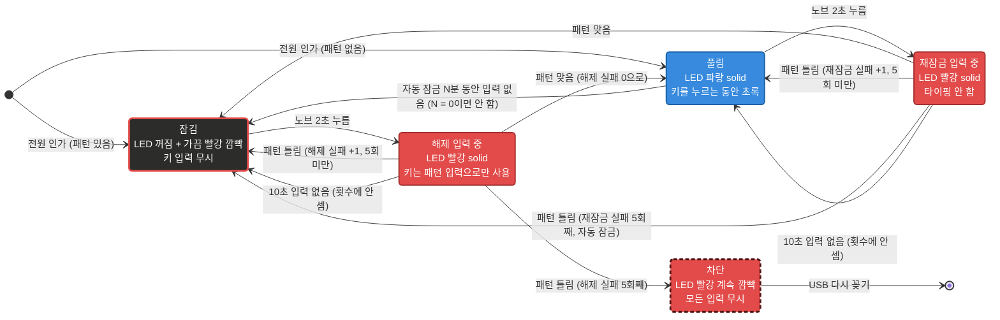

# USB-mini-keyboard-6k1n

상용 미니 매크로 키보드(CH552G, CH32V203)에 커스텀 펌웨어를 올려 키마다 **긴 문자열**을 HID 키보드로 출력하는 프로젝트.

- 대상 보드 ([요약 표](docs/BOARDS.md))
  - CH552G, 키 6개 + 노브 1개: **MK6K1N**(LED 1개), **MK6K1NL**(키마다 LED)
  - CH32V203C8U6, 노브 없음: **3X3V_RGB**(9키), **2X4V_RGB**(8키), 키마다 RGB LED
- PC GUI에서 문자열 확인·수정
- 펌웨어 업로드, 설정, 문자열 출력을 모두 USB 포트 하나로 처리

## 현재 버전 (2026-11-07)

<!-- gen:versions -->
| 항목 | 버전 | 정의한 곳 |
|---|---|---|
| 펌웨어 | 1.7.0 | `firmware/macro_keyboard/src/config.h` |
| GUI | 1.7.0 | `gui/core/version.py` |
| Python 프로젝트 | 1.7.0 | `pyproject.toml` |
| CH32V203 부트로더 | 1.0 | `firmware/bootloader_ch32v203/main.c` |
| 설정 프로토콜 | 2 | `firmware/macro_keyboard/src/core/protocol.h` |
| 보드 정보 (HELLO) | 1 | `firmware/macro_keyboard/src/config.h` |
<!-- /gen:versions -->

- 표는 `tools/gen_docs.py`가 코드에서 만듦(손으로 고치지 않음)
- 버전 변수: 펌웨어 `FW_MAJOR`/`FW_MINOR`/`FW_PATCH`, GUI `VERSION`, 부트로더 `BL_VER_MAJOR`/`BL_VER_MINOR`
- 설정 통신 규격: [docs/PROTOCOL.md](docs/PROTOCOL.md)

- 지원 보드: MK6K1N, MK6K1NL (CH552G) / 3X3V_RGB, 2X4V_RGB (CH32V203C8U6)

## 핵심 요구사항

| # | 요구사항 | 현재 상태 |
|---|---|---|
| 1 | 시중 매크로 키보드의 **핀맵을 식별해서 펌웨어를 개조** | ✅ 4개 보드 핀맵 식별, 본 펌웨어로 실제 장치 동작 확인 ([BOARDS.md](docs/BOARDS.md)) |
| 2 | **키마다 길게(약 20자 이상)** 입력 (원래 제품은 약 8자) | ✅ CH552 보드: 9개 슬롯이 **합계 102자**(DataFlash 128바이트)를 나눠 씀. 노브에 키 하나씩 넣으면 키 6개 합계 85자(평균 약 14자). CH32V203 보드: 합계 4070자(9키)·4072자(8키). **GUI가 전체·남은 글자 수를 계산해 저장 가능 여부 표시** |
| 3 | 노브는 **단순 기능**(방향키, Enter 등 키 하나)으로 충분 | ✅ 노브 시계 방향/반시계 방향/누르기에 키 하나 또는 짧은 매크로 할당 |
| 4 | **연결할 때마다 패턴 암호를 입력해야 출력**(아무나 못 쓰게). 패턴은 GUI에서 설정. 입력 전 빨간 LED, 통과 후 파란 LED | ✅ 모든 보드, 실제 장치에서 동작 확인 |

> **결정**: CH552 보드는 코드 Flash는 쓰지 않고 DataFlash만 사용함.
> - 6개 키 모두 20자를 동시에 넣을 수는 없음
> - 길이 배분은 GUI의 용량 표시로 관리

## 현재 상태

| 기능 | 내용 |
|---|---|
| 하드웨어 조사 | ✅ 4개 보드 핀·LED·부트로더 확인 ([BOARDS.md](docs/BOARDS.md)) |
| 본 펌웨어 ([firmware/macro_keyboard](firmware/macro_keyboard/)) | ✅ 키별 문자열 입력, 빌드와 PC 검사(host_test) 통과 |
| 설정 통신 규격 | ✅ [docs/PROTOCOL.md](docs/PROTOCOL.md) |
| 설정 GUI | ✅ 실제 장치와 동작 확인. 키보드 없이 `--mock`으로도 실행 가능 |
| 패턴 암호 (잠금) | ✅ 2~8단계, 노브(노브 없는 보드는 아무 키) 2초로 입력 시작, 다시 잠그기, 자동 잠금 N분 ([잠금 상태도](#잠금-상태도)). 확인 절차: [firmware/macro_keyboard/README.md](firmware/macro_keyboard/README.md#4-잠금-확인) |
| 보드 정보 | ✅ HELLO로 칩·키/노브 수·보드 이름을 알리고 GUI가 그 배치로 화면 구성 ([docs/BOARD_INFO.md](docs/BOARD_INFO.md)) |
| 펌웨어 업데이트 | ✅ GUI 업데이트 창: 장입할 보드 선택, 파일 식별 문자열 확인, 식별 못 한 키보드(공장 펌웨어 등)도 확인 후 장입. CH32V203 보드는 **자체 HID 부트로더**로 브리지 없이 업데이트(처음 한 번만 BOOT 브리지, [docs/BOOTLOADER_CH32V203.md](docs/BOOTLOADER_CH32V203.md)) |
| 키별 LED | ✅ MK6K1NL·3X3V_RGB·2X4V_RGB: 누르는 동안 누른 키만 초록, 나머지는 꺼짐 |

### 이력

- 2026-10-26 (v1.0~v1.1): 본 펌웨어·GUI, 패턴 암호(프로토콜 v2), 실제 장치 확인
- v1.2: 잠긴 동안 키 무시, 노브 길게 누르기로 입력 시작, 다시 잠그기. v1.2.1: 크기 11,587 → 8,151바이트 ([old/FIRMWARE_SIZE](docs/old/FIRMWARE_SIZE.md))
- v1.3: 보드 정보(HELLO), 업데이트 창 보드 목록·칩 표·식별 문자열. v1.3.1: 노브 3초 → 2초
- 2026-10-27 (v1.4): 자동 잠금
- 2026-10-31 (v1.5): MK6K1NL(키마다 LED)
- v1.6: 패턴 2단계부터(전에는 4단계), 입력 표시, 장입할 보드 고르기
- 2026-11-07: 1.7.0(CH32V203 지원, 노브 진입 삭제, 초록 LED 변경, CH552 색 바퀴). 3X3V_RGB·2X4V_RGB, 자체 HID 부트로더, 노브 없는 보드는 키를 누를 때 입력

## 잠금 상태도

- 사용 방법·확인 절차: [firmware/macro_keyboard/README.md](firmware/macro_keyboard/README.md#잠금)



### 그림 읽는 법

- 박스 색 = 그 상태의 LED 색
- 검정 바탕 + 빨간 테두리 = 꺼져 있고 가끔 빨강 깜빡
- 점선 테두리 = 계속 깜빡임
- 풀림에서 키를 누르는 동안의 초록은 별도 박스 없음

### 상태별 LED

| 상태 | LED |
|---|---|
| 잠김 (전원 인가 직후 포함) | 꺼짐, 약 3초마다 빨강 짧게(0.1초) 깜빡임 |
| 해제 입력 중 / 재잠금 입력 중 | 빨강 solid |
| 차단 (해제 실패 5회) | 빨강 계속 깜빡임 (약 0.5초 간격) |
| 풀림 | 파랑 solid |
| 풀림에서 키를 누름 | 누르는 동안 초록, 떼면 바로 파랑 (짧게 눌러도 최소 0.2초, 노브 회전은 0.2초). 긴 문자열은 뗀 뒤에도 파랑인 채 계속 입력. 키마다 LED인 보드는 누른 키만 초록, 나머지는 꺼짐(노브는 모두 초록) |
| 설정 저장 완료 | 흰색 0.3초 |
| 부트로더 진입 | 보라 |

### 동작 규칙

- 패턴이 틀리면 그 자리에서 다시 받지 않고 이전 상태(잠김 또는 풀림)로 돌아감. 다시 하려면 노브 2초부터
- 재잠금 실패 5회로 자동 잠금되면 '차단'이 아니라 '잠김'이 됨
  - 노브 2초 + 맞는 패턴으로 바로 풀 수 있음
  - 해제 실패 횟수는 새로 5번
- 재잠금 실패 횟수는 재잠금 성공 또는 잠김에서 다시 풀리면 0이 됨
- **자동 잠금**: GUI에서 정한 N분(0~255) 동안 입력이 없으면 풀림 → 잠김
  - 입력 = 키/노브 입력, GUI 작업(읽기·저장·테스트 입력)
  - 0분이면 자동 잠금 안 함
  - 해제 실패 횟수는 새로 5번
- 패턴 암호가 저장되어 있으면 노브 누르기 문자열은 뗄 때(2초 미만) 입력됨
- **노브 없는 보드(8/9키)**: 그림의 "노브 2초"는 **아무 키 2초**
  - 패턴 단계는 키만
  - 키는 누를 때 입력(암호가 있어도). 풀린 상태에서 2초 눌러 다시 잠그면 그 키가 한 번 입력됨 ([MANUAL 10장](docs/MANUAL.md#10-노브-없는-보드에서-다른-점))
- 꽂는 순간 진입 키(키 D / 9키 키 7 / 8키 키 5)를 누르고 있으면 부트로더로 들어가므로, 2초 누르기는 꽂은 뒤에 함

### 이력 (잠금)

- v1.1: 잠긴 동안 키 입력을 바로 패턴으로 받음, 다시 잠그기 없음
- v1.2: 지금 상태도의 기본 동작. v1.3.1: 노브 3초 → 2초. v1.4: 자동 잠금. v1.6: 패턴 2~8단계
- 2026-11-07: 노브 없는 보드는 키를 누를 때 입력(전에는 뗄 때)
- 2026-11-07: 초록 = 키를 누르는 동안(전에는 출력하는 동안)
- 2026-11-07: 누르는 동안 나머지 LED 꺼짐(전에는 파랑)

## 하드웨어 요약

- 보드별 칩·키·LED·부트로더·진입 키: [docs/BOARDS.md](docs/BOARDS.md)
- 핀·확인 결과: `docs/board/BOARD_<보드>.md` ([MK6K1N](docs/board/BOARD_MK6K1N.md), [MK6K1NL](docs/board/BOARD_MK6K1NL.md), [3X3V_RGB](docs/board/BOARD_3X3V_RGB.md), [2X4V_RGB](docs/board/BOARD_2X4V_RGB.md))

## 폴더 구조

**문서 (`docs/`)**

| 구분 | 문서 | 내용 |
|---|---|---|
| 공통 | [MANUAL.md](docs/MANUAL.md) | **사용 설명서**: 사용·설정·펌웨어 업데이트·복구 (모든 보드) |
| 공통 | [TROUBLESHOOTING.md](docs/TROUBLESHOOTING.md) | 실제로 겪은 문제와 해결 방법(빌드 오류, 업로드 실패와 복구 등) |
| 공통 | [PROTOCOL.md](docs/PROTOCOL.md) | 펌웨어와 GUI가 공유하는 Vendor HID 설정 통신 규격 |
| 보드 요약 | [BOARDS.md](docs/BOARDS.md) | **보드마다 다른 점 한 표**: 칩, 키/노브, LED, 저장 용량, 부트로더·진입 키, 처음 설치, 펌웨어 파일 |
| 보드 추가 | [NEW_BOARD.md](docs/NEW_BOARD.md) | 새 키보드를 이 펌웨어로 바꾸는 절차: 식별, 안전, 진입 방법, 핀 찾기, 보드 파일, 설치·확인, 문서화 |
| 보드 추가 | [board/_TEMPLATE.md](docs/board/_TEMPLATE.md) | 보드 문서 양식(절 순서, 표 열), 그림 다시 그리기 |
| 출시 | [RELEASE.md](docs/RELEASE.md) | 출시 체크리스트: 문서 반영 → 버전 → 문서 생성 → 빌드 → pytest → 장치 확인 → 변경 기록 → 커밋 |
| 출시 | [CHANGELOG.md](CHANGELOG.md) | 저장소 전체 변경 기록: `## 미출시` 항목(문서 영향·반영 표시)과 버전별 요약 |
| 보드 세부 | [board/BOARD_MK6K1N.md](docs/board/BOARD_MK6K1N.md) | 6키 + 노브, LED 1개. 버튼 매핑, CH552G 칩 핀맵, 노브 신호 |
| 보드 세부 | [board/BOARD_MK6K1NL.md](docs/board/BOARD_MK6K1NL.md) | 6키 + 노브, 키마다 LED. 버튼 매핑, 칩 핀맵, LED 체인 |
| 보드 세부 | [board/BOARD_3X3V_RGB.md](docs/board/BOARD_3X3V_RGB.md) | 9키 (CH32V203). 버튼 매핑, 48핀 칩 핀맵, LED, 부팅, 확인 결과 |
| 보드 세부 | [board/BOARD_2X4V_RGB.md](docs/board/BOARD_2X4V_RGB.md) | 8키 (CH32V203). 버튼 매핑, 48핀 칩 핀맵, LED, 부팅, 확인 결과 |
| 설계 | [BOARD_INFO.md](docs/BOARD_INFO.md) | 보드 정보(HELLO), 보드 목록, 칩 표 설계 |
| 설계 | [BOOTLOADER_CH32V203.md](docs/BOOTLOADER_CH32V203.md) | CH32V203 자체 HID 부트로더: 플래시 배치, 시작 순서, 명령 |
| 옛 문서 | [old/PORT_CH32V203.md](docs/old/PORT_CH32V203.md) | CH32V203 이식 계획·기록 (끝남) |
| 옛 문서 | [old/FIRMWARE_SIZE.md](docs/old/FIRMWARE_SIZE.md) | CH552 펌웨어 크기 줄이기 제안과 결과 (끝난 분석) |
| 옛 문서 | [old/PLAN.md](docs/old/PLAN.md) | 초기 계획, 하드웨어 조사 기록 (역사) |
| 안내 | [PINMAP.md](docs/PINMAP.md) | 옛 핀 배치 문서 → 보드 문서로 안내 |

**그 밖의 폴더**

| 경로 | 내용 |
|---|---|
| [firmware/macro_keyboard/](firmware/macro_keyboard/) | 본 펌웨어 (빌드, 업로드, 동작 테스트 방법 포함) |
| [gui/](gui/) | PySide6 설정 프로그램. `core/`(장치 논리, Qt 없음), `ui/`(창·위젯) |
| [tests/gui/](tests/gui/) | GUI pytest 테스트 (`uv run pytest`) |
| [tests/host/](tests/host/) | 본 펌웨어의 기능 코드(`src/core`)를 PC(gcc)에서 검사 |
| [tests/hw/mk6k1n/test_pinmap/](tests/hw/mk6k1n/test_pinmap/) | MK6K1N 하드웨어 확인용 테스트 펌웨어. **새 장치를 구하면 먼저 이걸로 점검** |
| [tests/hw/mk6k1nl/test_mk6k1nl/](tests/hw/mk6k1nl/test_mk6k1nl/) | MK6K1NL(키마다 LED) 하드웨어 확인용 테스트 펌웨어: LED 체인 순서와 키 핀 |
| [tests/hw/ch32v203/test_ch32v203/](tests/hw/ch32v203/test_ch32v203/) | CH32V203 보드(8키, 9키) 하드웨어 확인: GPIO 감시, LED 핀 탐색 |
| [tools/](tools/) | 개발용 스크립트 (아래 표) |

| tools/ 파일 | 용도 |
|---|---|
| `flash.ps1` | 부트로더 대기 후 자동 업로드. `-Hex`: CH552, `-Board 3x3v_rgb`/`2x4v_rgb`: 자체 부트로더로 장입, `-Full`: 처음 설치(BOOT 브리지, wchisp로 부트로더만 → 진입 키로 앱) |
| `usb_monitor.ps1` | USB 장치 감지 기록 |
| `build_fw.ps1` | 펌웨어 빌드, `-Board`로 보드 선택, 빌드 일자 기록 |
| `build_gui.ps1` | GUI exe 빌드, 빌드 일자 기록 |
| `capture_screens.py` | 문서용 GUI 화면 캡처 |
| `draw_pinmap.py` | 문서용 보드별 핀 그림 |

## 빠른 시작

- 사용 방법: [사용 설명서(docs/MANUAL.md)](docs/MANUAL.md)
- 아래는 개발용 빌드·실행 방법

### 펌웨어 빌드

- 환경: Arduino IDE + CH55xDuino 0.0.26
- 보드 설정, Windows 빌드 오류 패치: [tests/hw/mk6k1n/test_pinmap/README.md](tests/hw/mk6k1n/test_pinmap/README.md)
- 빌드 일자를 넣으려면 스크립트로 빌드 (버전은 `firmware/macro_keyboard/src/config.h`)

```powershell
powershell -ExecutionPolicy Bypass -File tools\build_fw.ps1
```

- 결과 (`firmware\macro_keyboard\build\`)
  - `macro_keyboard-MK6K1N.hex`: 보드 이름이 붙은 파일, GUI가 먼저 고름
  - `macro_keyboard.ino.hex`
- 키마다 LED가 있는 보드: `-Board mk6k1nl`로 빌드 → `macro_keyboard-MK6K1NL.hex`
- CH32V203 보드: `-Board 3x3v_rgb`(9키), `-Board 2x4v_rgb`(8키) → 앱 `.bin` + 부트로더 + 전체 이미지 ([BOOTLOADER_CH32V203.md](docs/BOOTLOADER_CH32V203.md) 빌드)
- 보드별 파일 이름: [BOARDS.md](docs/BOARDS.md)

### 펌웨어 업로드

- 보드 공통 절차: [사용 설명서 8장](docs/MANUAL.md#8-펌웨어-업데이트). 아래는 CH552 보드 스크립트 예

1. 스크립트 실행

   ```powershell
   powershell -ExecutionPolicy Bypass -File tools\flash.ps1 -Hex <빌드한 .hex 파일>
   ```

2. 키 D를 누른 채 키보드 연결

### GUI 실행

- 설치 방법: [gui/README.md](gui/README.md)

```powershell
uv run python -m gui --mock
```

### GUI exe 빌드

- 빌드 일자가 exe에 기록됨, 버전은 `gui/core/version.py`

```powershell
powershell -ExecutionPolicy Bypass -File tools\build_gui.ps1
```

## 라이선스 참고

- `tests/hw/mk6k1n/test_pinmap/src/userUsbHidKeyboard/`의 USB 코드: [CH55xDuino](https://github.com/DeqingSun/ch55xduino) HidKeyboard 예제에서 가져옴 (LGPL-2.1)
