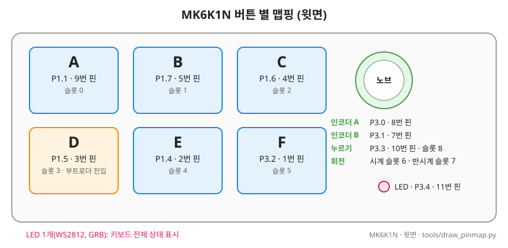
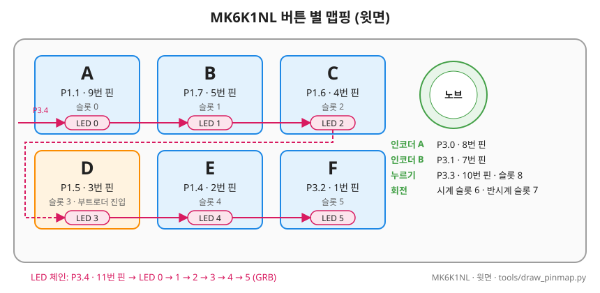
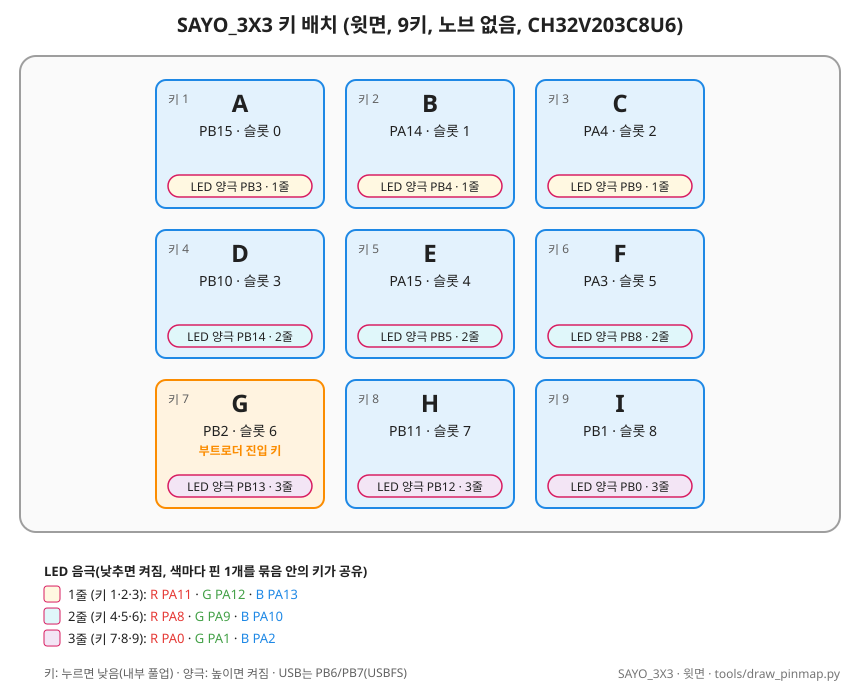
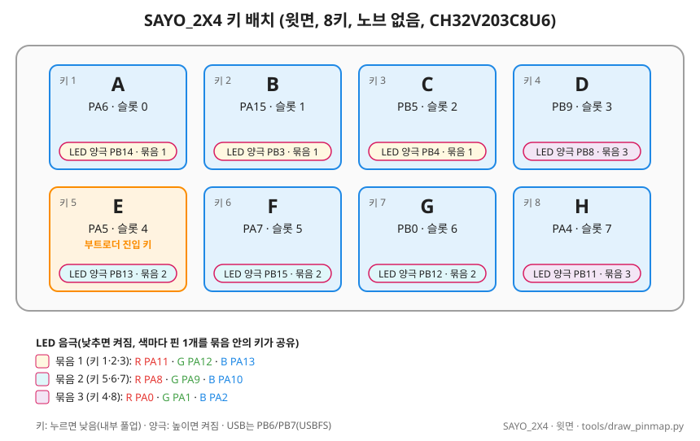

# 지원 보드 요약

- 보드마다 다른 점만 모은 표. 사용법·업데이트 절차는 공통 문서 [MANUAL.md](MANUAL.md)
- 요구사항·식별자: [REQUIREMENTS.md](REQUIREMENTS.md)
- 핀·LED·확인 결과는 보드별 세부 문서
- 보드 이름 = HELLO 보드 이름 = 펌웨어 보드 파일(`firmware/macro_keyboard/src/boards/<보드>.h`) = GUI 보드 목록(`gui/core/boards.py`)

## 구성

<!-- gen:boards -->
| 보드 | 칩 | 키 / 노브 / 줄 | LED | 업데이트 진입 | 처음 설치 | 펌웨어 파일 |
|---|---|---|---|---|---|---|
| MK6K1N | CH552 | 6 / 1 / 2 | WS2812 (체인 8자리에 같은 색) | 키 D | 키 E를 누른 채 꽂으세요 | `firmware/macro_keyboard/build/macro_keyboard-MK6K1N.hex` |
| MK6K1NL | CH552 | 6 / 1 / 2 | 키마다 WS2812 6개 | 키 D | 키로는 들어가지 않습니다. 칩 12번(D+)과 16번(3V3) 핀 사이에 1.5~2kΩ 저항을 댄 채 꽂으세요 (docs/TROUBLESHOOTING.md 2-3) | `firmware/macro_keyboard/build/macro_keyboard-MK6K1NL.hex` |
| SAYO_3X3 | CH32V203 | 9 / 0 / 3 | 키마다 RGB LED 9개 (PWM) | 키 7 | `tools\flash.ps1 -Board sayo_3x3 -Full` | `firmware/macro_keyboard/build/ch32v203/macro_keyboard-SAYO_3X3.bin` |
| SAYO_2X4 | CH32V203 | 8 / 0 / 2 | 키마다 RGB LED 8개 (PWM) | 키 5 | `tools\flash.ps1 -Board sayo_2x4 -Full` | `firmware/macro_keyboard/build/ch32v203/macro_keyboard-SAYO_2X4.bin` |
| SAYO_2X6 | CH32V203 | 12 / 0 / 2 | 키마다 RGB LED 12개 (PWM) | 키 7 | `tools\flash.ps1 -Board sayo_2x6 -Full` | `firmware/macro_keyboard/build/ch32v203/macro_keyboard-SAYO_2X6.bin` |
| SAYO_2B3 | CH573 | 6 / 0 / 2 | 키 LED 없음, 단색 상태 LED 6개 | 키 4 | `tools\flash.ps1 -Board sayo_2b3 -Full` | `firmware/macro_keyboard/build/ch573/macro_keyboard-SAYO_2B3.bin` |
<!-- /gen:boards -->

- 표는 `tools/gen_docs.py`가 `gui/core/boards.py`에서 만듦
- 칩: CH552 = CH552G, CH32V203 = CH32V203C8U6
- 저장 용량(문자열 합계 최대): MK6K1N·MK6K1NL 128바이트(102자), SAYO_3X3 4096바이트(4070자), SAYO_2X4 4096바이트(4072자), SAYO_2X6 4096바이트(4064자), SAYO_2B3 2048바이트(2028자)
- RGB 보드의 LED: 색별 음극(캐소드) 묶음 + 키별 양극(애노드)
- 세부 문서: [MK6K1N](board/BOARD_MK6K1N.md), [MK6K1NL](board/BOARD_MK6K1NL.md), [SAYO_3X3](board/BOARD_SAYO_3X3_RGB.md), [SAYO_2X4](board/BOARD_SAYO_2X4_RGB.md), [SAYO_2X6](board/BOARD_SAYO_2X6_RGB.md)(본 펌웨어 확인 중), [SAYO_2B3](board/BOARD_SAYO_2X3B_RGB.md)

- 노브 없는 보드: 패턴 입력 시작은 **아무 키 2초**, 단계는 키만, 키는 누를 때 입력([REQ-KEY-05](REQUIREMENTS.md#key-입력)) ([MANUAL 10장](MANUAL.md#10-노브-없는-보드에서-다른-점))
- 패턴 암호·자동 잠금: 모든 보드에 있음
- 키마다 LED인 보드: 풀린 상태에서 누르는 동안 누른 키만 초록, 나머지는 꺼짐(노브는 모두 초록)
- 꽂을 때 LED 점검(`BOARD_LED_SELF_TEST`): 모든 보드. 그동안 키 입력은 되지만 키 LED 표시는 없음. 색 바퀴(빨강→노랑→초록→청록→파랑→보라→빨강)를 한 바퀴 3초씩 2번 → 0.3초 꺼짐 (약 6.3초). 키마다 LED인 보드는 빛이 키 둘레를 시계방향으로 흐름(SAYO_2X6은 빛 2개, 다른 보드는 1개, 각 보드 문서 4·6절)

### 키 배치 그림

| MK6K1N | MK6K1NL |
|---|---|
|  |  |
| **SAYO_3X3** | **SAYO_2X4** |
|  |  |

- 주황 = 부트로더 진입 키. 칩 핀맵 그림(`pinmap_<보드>.svg`)은 각 보드 문서 3절. 그림 다시 그리기: [board/_TEMPLATE.md](board/_TEMPLATE.md#그림-만들기)

## 확인 중인 보드

- 지원 보드(위 생성 표·업데이트 표)지만 기판 확인이 덜 끝난 보드
- SAYO_2X6(SayoDevice 12키, 기판 `2x6_RGB`, CH32V203C8U6): 칩·키·LED 핀 확인 끝, 자체 부트로더·꽂을 때 LED 점검 확인. 본 펌웨어 키 입력·GUI 설정은 확인 전([보드 문서](board/BOARD_SAYO_2X6_RGB.md))
- SAYO_2B3(SayoDevice 6키 무선, 기판 `2x3M_BLE_Ver1.1`, CH573F QFN28): 키·LED 핀, 전원 확인. 자체 부트로더(`firmware/bootloader_ch573`, 진입 키 4, [BOOTLOADER_CH573.md](BOOTLOADER_CH573.md)) 설치·확인. 본 펌웨어: USB 유선 + 블루투스 슬롯 3개, 배터리 %. 기판 확인(2026-11-16, 판 131,648 B): 슬롯 1 PC·슬롯 2 휴대폰 입력, 재연결, 슬롯 분리([REQ-BLE-01·04·13](REQUIREMENTS.md#ble-무선동글)). 확인 전: 슬롯 3, 키 5·6 누를 때 입력, GUI 설정([보드 문서](board/BOARD_SAYO_2X3B_RGB.md))

## 준비 중 보드

- 동글(SAYO_2B3용 USB 동글, CH582F): 우리 펌웨어 `firmware/dongle_ch582`(`1209:C55F`, [BOARD_DONGLE_CH582.md](board/BOARD_DONGLE_CH582.md)) 빌드만, 미장입. SAYO_2B3와 연결은 다음([REQ-BLE-12](REQUIREMENTS.md#ble-무선동글))
- JUZH_3B4: 12키(가로: 3행 × 4열 왼쪽) + 노브 2(오른쪽 위·아래) 무선, 반시계 90° 세로(키 4×3 아래, 노브 위쪽 왼쪽·오른쪽)도 씀(GUI "세로 보기"), 노브 사이 LED 3개 = BT 슬롯 LED(계획), 충전 LED 2개(3색 패키지로 보임, 확인된 색 R·G, 하드웨어 표시 추정), 핀 미확인, 본 펌웨어 HAL 초안 있음(`src/hal/ac6321a/`, 칩 미검증, 핀 미정), GUI는 준비 중 목록(`PREPARING`), 칩 각인 `BP3D136-21A4`(QFN32 4×4, 24 MHz 크리스털, JieLi AC6321A(BD19 = AC632N 계열, BLE 전용) 확정(UBOOT 이름 BD19, 실크 점 = 1번, RF·OSC 배치, USB0 14·15 도통, 사용자 확인. AC6956C 판단 철회, [칩 특성](CHIPS.md#jieli-ac6321a-juzh_3b4-준비-중))). 공장 펌웨어 USB `514C:8850`(HID). **시험 펌웨어 장입 뒤 USB·BLE 안 잡혀 복구 불가, 보류**(2026-11-15. ROM 진입은 USB 키·UART 키 하드웨어뿐, 납땜·어댑터 불가. 되살리려면 Blue Pill USB 키 송신기(납땜 없음, 실물 미시험), 납땜 지원 또는 JieLi USB 업데이터 동글). 공장 펌웨어 백업 있음(저장소 밖). 장입 경로는 ROM USB 모드(UBOOT): 처음 설치는 공장 벤더 HID `03 EF EF`로 진입(확인), 이후 GUI BOOT 명령(구현됨, 실기 미확인)
- SAYO_2X6 이름은 확정(기판 `2x6_RGB`). SAYO_2B3 이름도 확정(옛 이름 BT_2X3, 2026-11-13). JUZH_3B4 이름 확정(2026-11-15). 파일 위치와 할 일: [NEW_BOARD.md 9절](NEW_BOARD.md#9-식별-전-보드)

| 이름 | 제품 | 배치 | 칩 | 문서 |
|---|---|---|---|---|
| 동글 | SAYO_2B3용 USB 동글(버튼·LED 없음) | – | CH582F | [BOARD_DONGLE_CH582.md](board/BOARD_DONGLE_CH582.md) |
| JUZH_3B4 | 판매처 확인 필요, 12키 + 노브 2(가로 기준 오른쪽 위·아래, 세로로도 씀), 무선, 기판 `KEY12-JUZHEN_V01` | 3행 × 4열 | JieLi AC6321A(각인 `BP3D136-21A4`, 보류: 복구 불가) | [BOARD_KEY12_JUZHEN_V01.md](board/BOARD_KEY12_JUZHEN_V01.md) |

## 펌웨어 업데이트

| 보드 | 부트로더 | 진입 (누른 채 꽂기) | 처음 설치 (공장 펌웨어) | 장입 도구 | 펌웨어 파일 |
|---|---|---|---|---|---|
| **MK6K1N** | WCH ROM (USB `4348:55E0`) | **키 D**(P1.5) | 키 E를 누른 채 꽂기 | GUI(vnproch55x), `flash.ps1 -Hex` | `macro_keyboard-MK6K1N.hex` |
| **MK6K1NL** | WCH ROM (USB `4348:55E0`) | **키 D**(P1.5) | D+ 풀업: 칩 12번–16번에 1.5~2kΩ | GUI(vnproch55x), `flash.ps1 -Hex` | `macro_keyboard-MK6K1NL.hex` |
| **SAYO_3X3** | 자체 HID (USB `1209:C55E`) | **키 7**(왼쪽 아래, PB2) | BOOT 브리지 + `flash.ps1 -Board sayo_3x3 -Full` → 키 7 누른 채 다시 꽂기 | GUI(hidboot), `flash.ps1 -Board sayo_3x3` | `ch32v203/macro_keyboard-SAYO_3X3.bin` |
| **SAYO_2X4** | 자체 HID (USB `1209:C55E`) | **키 5**(왼쪽 아래, PA5) | BOOT 브리지 + `flash.ps1 -Board sayo_2x4 -Full` → 키 5 누른 채 다시 꽂기 | GUI(hidboot), `flash.ps1 -Board sayo_2x4` | `ch32v203/macro_keyboard-SAYO_2X4.bin` |
| **SAYO_2X6** | 자체 HID (USB `1209:C55E`) | **키 7**(왼쪽 아래, PA7) | BOOT 브리지 + `flash.ps1 -Board sayo_2x6 -Full` → 키 7 누른 채 다시 꽂기 | GUI(hidboot), `flash.ps1 -Board sayo_2x6` | `ch32v203/macro_keyboard-SAYO_2X6.bin` |
| **SAYO_2B3** | 자체 HID (USB `1209:C55E`) | **키 4**(왼쪽 아래, PA9) **누른 채 SW1 켜기** | `flash.ps1 -Board sayo_2b3 -Full` 먼저 실행 → PB22-GND + SW1 켜기(ROM 6~15초) | GUI(hidboot), `flash.ps1 -Board sayo_2b3` | `ch573/macro_keyboard-SAYO_2B3.bin` |

- 모든 보드: 잠금 풀린 키보드는 GUI [업데이트 모드로 전환] 단추(BOOT 명령)으로 키 없이 진입. 업데이트 모드 LED는 **보라**(SAYO_2B3는 빨강 L5 깜빡임)
- 펌웨어 파일 위치: `firmware/macro_keyboard/build/` (`tools\build_fw.ps1 -Board <보드>`)
- 앱 USB: 모든 보드 `1209:C55D`
- 펌웨어 최대 크기: CH552 14,336바이트, CH32V203 52,992바이트(앱 영역, [플래시 배치](BOOTLOADER_CH32V203.md)), CH573 446,464바이트([플래시 배치](BOOTLOADER_CH573.md#플래시-배치-448-kb-boot_layouth))
- 설정 유지: CH552는 DataFlash라 항상 유지. CH32V203은 자체 부트로더 업데이트와 `-Full`(부트로더만 wchisp, 앱은 HID) 모두 유지. 공장 펌웨어(읽기 보호)는 처음 설치 때 전부 지워짐
- ⚠️ CH32V203 보드의 제조사 펌웨어는 읽기 보호 → 처음 설치 때 지워짐(되돌릴 수 없음)

## 새 보드 추가

- 전체 절차(식별, 안전, 진입 방법, 핀 찾기, 설치·확인): [NEW_BOARD.md](NEW_BOARD.md). 아래는 요약

1. 칩 확인 (**다운로드는 하지 않음**)
   - CH55x: WCHISPTool 칩 목록, 또는 D+ 풀업으로 업데이트 모드에 넣고 업로더 출력의 `Found Device`
   - CH32V203: BOOT 브리지 + `wchisp info` (읽기 보호 상태만 확인)
2. 시험 펌웨어로 키 핀, 노브 신호, LED 순서·극성 확인
   - MK6K1N 계열: [test_pinmap](../tests/hw/mk6k1n/test_pinmap/README.md)
   - LED가 여러 개(CH552): [test_mk6k1nl](../tests/hw/mk6k1nl/test_mk6k1nl/README.md)
   - CH32V203·핀을 전혀 모를 때: [test_ch32v203](../tests/hw/ch32v203/test_ch32v203/README.md). GPIO 전부 감시, LED 핀 탐색
3. 추가할 것 ([BOARD_INFO 6~7절](BOARD_INFO.md))
   - 보드 파일 `src/boards/<보드>.h` (기판이 다르면 `<칩>_<배치>.h` 공통 파일도). CH32V203은 부트로더 진입 키 `BOARD_BOOT_KEY`
   - GUI 보드 목록 `gui/core/boards.py`
   - 이 문서의 표 두 개, 세부 문서 `board/BOARD_<보드>.md`(아래 목차)

### 세부 문서 목차 (보드 공통)

- 양식(절 제목, 표 열, 그림): [board/_TEMPLATE.md](board/_TEMPLATE.md)

1. 개요: 제품, 칩, 구성, 개발 보드 UID, 확인 근거
2. 버튼 배치와 매핑: 그림 `buttons_<보드>.svg` + 표(키, 슬롯, GPIO, 칩 핀, LED)
3. 칩 핀맵: 그림 `pinmap_<보드>.svg` + 표(핀 번호, 이름, 용도)
4. LED
5. 부팅·장입: 진입 키, 처음 설치, 평소 업데이트
6. 본 펌웨어에서의 동작: 보드 파일, 빌드, 다른 점
7. 확인 결과
- 이력은 각 절 끝 **이력**
