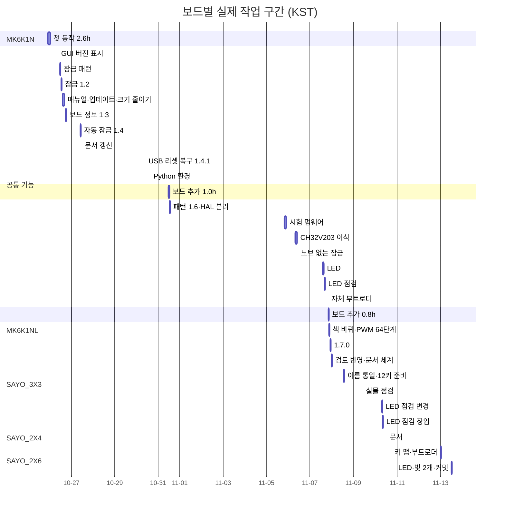

# 보드별 작업 시간

- 보드마다 실제로 든 작업 시간을 오래된 순으로 정리. 2026-11-13 집계
- 보드별 기능·핀은 [BOARDS.md](BOARDS.md), 작업 방식은 [WORKFLOW.md](WORKFLOW.md)

## 측정 방법

- 출처: 이 프로젝트 Claude Code 세션 기록(모든 세션, 하위 에이전트 포함)의 메시지 시각, KST
- **실제 작업 시간** = 앞뒤 메시지 간격이 15분 이하인 구간의 합
  - 여러 세션이 동시에 돈 시간은 한 번만 셈 → 사용자가 붙어 있던 시간에 가까움
  - 15분 넘는 손작업 공백(납땜 등)은 빠짐
- 보드 구분: 사용자 메시지·커밋 시각 기준
- 시간은 0.1 h 단위 반올림 → 합계가 0.1 h 정도 어긋날 수 있음

## 보드별 (오래된 순)

| 보드 | 칩 | 기간 | 실제 작업 | 사용자 메시지 | 한 일 |
|---|---|---|---|---|---|
| MK6K1N (6키 + 노브) | CH552, 새 칩 | 10-25 21:52 ~ 10-26 00:30 | 2.6 h | 40 | 개발 환경, 시험 펌웨어, 핀 찾기, 본 펌웨어 1.0, GUI |
| MK6K1NL (6키 + 노브, 키별 LED) | CH552 | 10-31 11:25 ~ 12:24 | 1.0 h | 28 | 핀 찾기, 보드 파일, GUI 목록 |
| SAYO_3X3 (9키) | CH32V203, 새 칩 | 11-05 07:47 ~ 11-07 20:16 | 6.9 h | 194 | 칩 이식(HAL), 키별 LED, 자체 부트로더 개발 |
| SAYO_2X4 (8키) | CH32V203 | 11-07 20:18 ~ 21:04 | 0.8 h | 19 | 핀 찾기, 보드 파일(부트로더는 9키 것 재사용) |
| SAYO_2X6 (12키) | CH32V203 | 11-13 00:08 ~ 12:59 | 1.5 h | 34 | 핀 찾기(매트릭스 감지 추가), 자체 부트로더, LED 점검·빛 2개 회전, 문서 |

공통 기능 (보드 표와 별도)

| 기간 | 실제 작업 | 한 일 |
|---|---|---|
| 10-26 ~ 10-30 | 5.4 h | 잠금, GUI, 펌웨어 크기 줄이기, 보드 정보, 자동 잠금 |
| 10-31 | 1.2 h | 패턴 2~8단계, HAL 분리 |
| 11-07 ~ 11-10 | 5.0 h | 1.7.0, 문서 체계, 이름 통일, 실물 점검, LED 점검 변경 |

- 전체 누적: 약 24.3 h

## 요점

- 새 칩의 첫 보드: 2.6 h(CH552), 6.9 h(CH32V203). 같은 칩 파생 보드: 0.8~1.5 h
- 12키는 8키보다 할 일이 많았지만(부트로더 설치, LED 점검, 매트릭스 감지, 문서) 차이는 0.7 h. 키 맵·부트로더 설치까지 첫 1시간 안
- 달력 기간 ≠ 작업 시간: 12키는 13시간 / 1.5 h, 9키는 3일 / 6.9 h
- 단축 요인: HAL·보드 파일 구조, 공용 시험 펌웨어, 장입 도구·자체 부트로더, 문서 양식, 역할별 세션
- 주의: 보드 5개뿐이고 보드마다 범위가 다름. 다음 BT_2X3(CH573F)은 새 칩

## 간트 차트

- 실제 작업 구간 중 5분 이상만 표시 → 막대 합은 위 표보다 조금 작음
- 공통 기능 막대 이름은 그 구간 앞뒤의 커밋 메시지 기준

**이력**

- 2026-11-13: 처음 만듦 (보드 5개)
