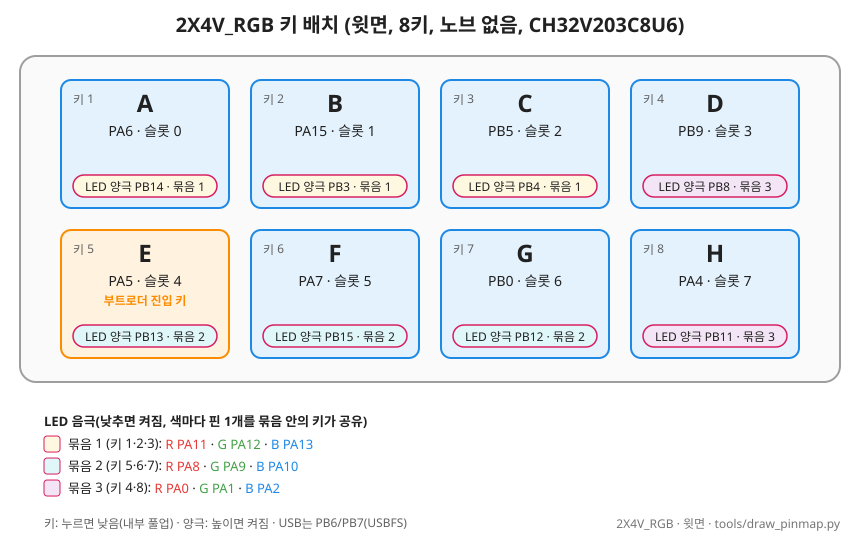
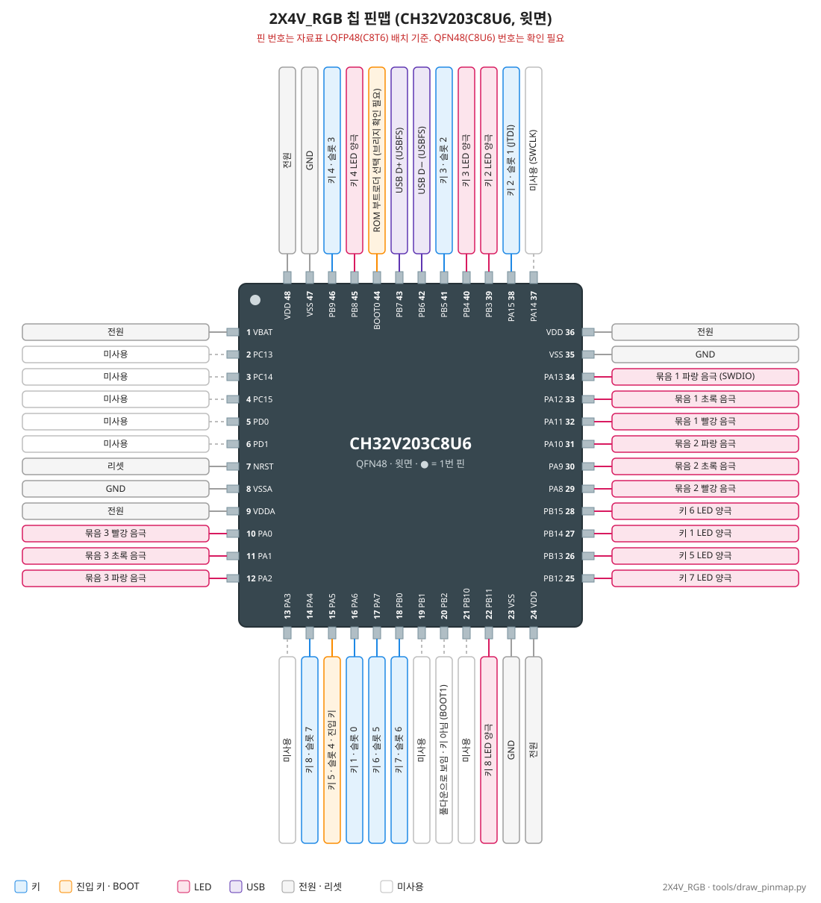
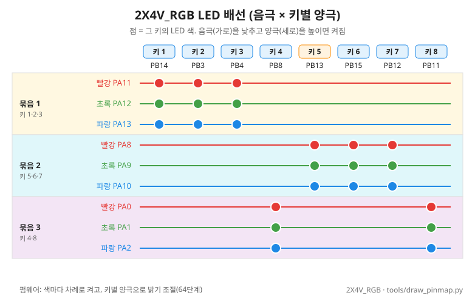

# 2X4V_RGB 보드 (8키, 키마다 RGB LED)

- 요약 표: [BOARDS.md](../BOARDS.md). 같은 계열 9키: [3X3V_RGB](BOARD_3X3V_RGB.md). 문서 양식: [_TEMPLATE.md](_TEMPLATE.md)

## 1. 개요

- 제품: SayoDevice Keyb T8B7
- 칩: **CH32V203C8U6** (9키와 같음, QFN48)
- 구성: 2×4 키, **노브 없음**, 키마다 3색 한 칩 RGB LED
- 개발 보드 UID: `CD-AB-30-92-4E-BD-4B-FB` (제조사 펌웨어는 보호 해제로 지워짐, 2026-11-07)
- 확인 근거: [test_ch32v203](../../tests/hw/ch32v203/test_ch32v203/README.md) KEYS·FIND·ANODE 모드 (2026-11-07)

## 2. 버튼 배치와 매핑

<!-- gen:pins-2X4V_RGB -->
| 키 | 키 GPIO (누르면 Low) | LED 양극 (High = 켜짐) |
|---|---|---|
| 1 | PA6 | PB14 |
| 2 | PA15 | PB3 |
| 3 | PB5 | PB4 |
| 4 | PB9 | PB8 |
| 5 (업데이트 진입) | PA5 | PB13 |
| 6 | PA7 | PB15 |
| 7 | PB0 | PB12 |
| 8 | PA4 | PB11 |

LED 음극 (Low = 켜짐, 묶음마다 공통)

| 묶음 | R | G | B |
|---|---|---|---|
| 1 | PA11 | PA12 | PA13 |
| 2 | PA8 | PA9 | PA10 |
| 3 | PA0 | PA1 | PA2 |
<!-- /gen:pins-2X4V_RGB -->

- 표는 `tools/gen_docs.py`가 보드 파일에서 만듦
- 슬롯 = 키 번호 − 1. 칩 핀 번호는 3절(확인 필요)
- 음극 묶음: 1 = 키 1·2·3, 2 = 키 5·6·7, 3 = 키 4·8
- 특수 핀: PA15 = JTDI(키 2), PA13 = SWDIO(묶음 1 파랑). 진입 키 5는 왼쪽 아래
- 번호: 1~4 윗줄, 5~8 아랫줄 (왼쪽부터)
- 누르면 낮음, 내부 풀업
- PA15는 JTAG 핀 → SWJ를 끄고 사용
- PB2(BOOT1)는 시작부터 낮음(보드에서 풀다운으로 보임), 키 아님

## 3. 칩 핀맵

- ⚠️ **핀 번호 확인 필요**: 9키와 같음([BOARD_3X3V_RGB.md 3절](BOARD_3X3V_RGB.md#3-칩-핀맵)). GPIO 이름과 용도는 확인됨

| 핀 번호 | 이름 | 용도 | 비고 |
|---|---|---|---|
| 10 / 11 / 12 | PA0 / PA1 / PA2 | 묶음 3 빨강 / 초록 / 파랑 음극 | |
| 14 | PA4 | 키 8 | |
| 15 | PA5 | 키 5 (진입 키) | |
| 16 | PA6 | 키 1 | |
| 17 | PA7 | 키 6 | |
| 18 | PB0 | 키 7 | |
| 20 | PB2 | 키 아님 (풀다운으로 보임) | BOOT1 |
| 22 | PB11 | 키 8 LED 양극 | |
| 25 / 26 / 27 / 28 | PB12 / PB13 / PB14 / PB15 | 키 7 / 5 / 1 / 6 LED 양극 | |
| 29 / 30 / 31 | PA8 / PA9 / PA10 | 묶음 2 빨강 / 초록 / 파랑 음극 | |
| 32 / 33 | PA11 / PA12 | 묶음 1 빨강 / 초록 음극 | USBD 핀이지만 이 보드는 USBD 안 씀 |
| 34 | PA13 | 묶음 1 파랑 음극 | SWDIO |
| 38 | PA15 | 키 2 | JTDI |
| 39 / 40 | PB3 / PB4 | 키 2 / 3 LED 양극 | |
| 41 | PB5 | 키 3 | |
| 42 / 43 | PB6 / PB7 | USB D− / D+ (USBFS) | |
| 44 | BOOT0 | ROM 부트로더 선택 | BOOT 브리지와의 연결 확인 필요 |
| 45 | PB8 | 키 4 LED 양극 | |
| 46 | PB9 | 키 4 | |
| 7 | NRST | 리셋 | |
| 13, 19, 21, 37, 2~6 | PA3, PB1, PB10, PA14, PC13~PC15 / PD0 / PD1 | 미사용 | PA14 = SWCLK |
| 1, 8, 9, 23, 24, 35, 36, 47, 48 | VBAT, VSSA, VDDA, VSS, VDD | 전원·GND | |

## 4. LED

| 묶음 | 키 | 빨강 | 초록 | 파랑 |
|---|---|---|---|---|
| 묶음 1 | 1·2·3 | PA11 | PA12 | PA13 |
| 묶음 2 | 5·6·7 | PA8 | PA9 | PA10 |
| 묶음 3 | 4·8 | PA0 | PA1 | PA2 |

- 음극(캐소드) 핀은 9키와 같고 묶음만 다름. **낮추면 켜짐**
- PA11/PA12: 시험 펌웨어는 건드리지 않아 추정 → 본 펌웨어 LED 점검(옛 방식: 빨강·초록·파랑·흰색)으로 확인 (2026-11-07)
- **키마다 양극(애노드) 핀**, 높이면 켜짐 (ANODE 모드, 핀은 2절 표)
- 구동 방식·밝기·꽂을 때 점검은 9키와 같음(색마다 차례로, 키별 양극으로 밝기, [BOARD_3X3V_RGB.md 4절](BOARD_3X3V_RGB.md#4-led)) → 묶음 구성은 펌웨어 동작에 영향 없음

## 5. 부팅·장입

- 평소 업데이트: 자체 HID 부트로더. **키 5를 누른 채 꽂기** 또는 GUI [업데이트 모드로 전환] → GUI 업데이트 창 (설정 유지)
- 처음 설치·복구: **BOOT 브리지**(BOOT1 실크 아래 패드 2개, 9키와 같은 방식)를 이은 채 꽂고 `tools\flash.ps1 -Board 2x4v_rgb -Full` → wchisp로 부트로더만 쓴 뒤 브리지 떼고 **키 5**를 누른 채 다시 꽂으면 앱을 HID로 씀 (우리 펌웨어가 있던 칩은 설정 유지, 공장 펌웨어는 전부 지워짐). 절차: [MANUAL 8장](../MANUAL.md#처음-설치-공장-펌웨어)
- 절차·플래시 배치: [BOOTLOADER_CH32V203.md](../BOOTLOADER_CH32V203.md)
- ⚠️ 제조사 펌웨어는 읽기 보호(WRP도 일부 걸림). 보호 해제 때 지워짐(되돌릴 수 없음)

## 6. 본 펌웨어에서의 동작

- 보드 파일: `firmware/macro_keyboard/src/boards/2x4v_rgb.h`
- 빌드: `tools\build_fw.ps1 -Board 2x4v_rgb` → 앱 `macro_keyboard-2X4V_RGB.bin`, 전체 이미지 `full-2X4V_RGB.bin`(`flash.ps1`은 안 씀)
- 슬롯 8개: 키 1~8. 문자열 합계 최대 4072자
- 잠금·LED·저장: 9키와 같음 ([BOARD_3X3V_RGB.md 6절](BOARD_3X3V_RGB.md#6-본-펌웨어에서의-동작)). 누르는 동안 누른 키만 초록, 나머지는 꺼짐

**이력**

- 2026-11-07: 누르는 동안 나머지 LED 꺼짐(전에는 파랑)

## 7. 확인 결과

| 항목 | 상태 |
|---|---|
| 키 8개 핀 | 확인 (2026-11-07) |
| LED 핀·극성, 키별 양극 | 확인 (2026-11-07) |
| LED 점검 (옛 방식: 빨강→초록→파랑→흰색→꺼짐) | 정상 (2026-11-07) |
| LED 점검 (색 바퀴 3초 × 2바퀴, 64단계 PWM, 최대 듀티 56/64) | 정상 (2026-11-07) |
| HELLO (보드 2X4V_RGB, 키 8, 2줄, 칩 0x19) | 확인 (2026-11-07) |
| 키 입력 1~8, 잠금·잠금 해제 | 확인 (2026-11-07) |
| 칩 핀 번호(QFN48) | 확인 필요 (3절) |
| 자체 부트로더: 설치, 키 5 진입, HID 장입 | 확인 (2026-11-07) |
| 1.7.0 HID 장입 (보드 검사) | `MKFW1:2X4V_RGB:CH32V203:1.7.0` = 부트로더 보드 → 통과. `check_device` v1.7.0, 설정(슬롯 8개) 유지. 부트로더는 바꾸지 않은 옛 빌드지만 보드 이름을 2X4V_RGB로 알려 문제없음 (2026-11-07) |
| USB 시리얼 | `2X4V_RGB` (보드 이름) |
