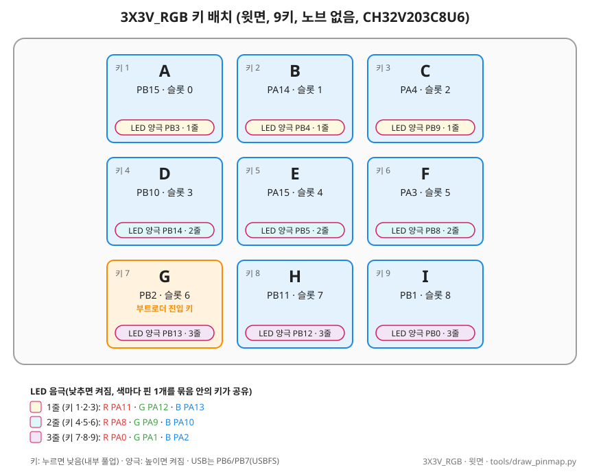
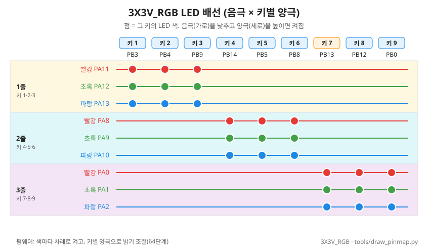

# 3X3V_RGB 보드 (9키)

- 요약 표: [BOARDS.md](../BOARDS.md)

## 1. 개요

- 제품: SayoDevice 계열 9키 매크로 키패드 (같은 계열 8키 = Keyb T8B7, [2X4V_RGB](BOARD_2X4V_RGB.md))
- 칩: **CH32V203C8U6** (RISC-V QingKe V4, 플래시 64 KB, RAM 20 KB, USB 풀스피드)
- 구성: 3×3 키, **노브 없음**, 키마다 3색 한 칩 RGB LED
- 확인 근거: [test_ch32v203](../../tests/hw/ch32v203/test_ch32v203/README.md) 시험(2026-11-05), 분해 확인(사용자)
- 보드 파일: `firmware/macro_keyboard/src/boards/3x3v_rgb.h`

## 2. 키 배치

| 키 | 1 | 2 | 3 | 4 | 5 | 6 | 7 | 8 | 9 |
|---|---|---|---|---|---|---|---|---|---|
| 핀 | PB15 | PA14 | PA4 | PB10 | PA15 | PA3 | PB2 | PB11 | PB1 |

- 번호: 왼쪽 위부터 행 순서 (1~3 윗줄)
- 누르면 낮음, 내부 풀업
- PA14·PA15는 SWD/JTAG 핀 → SWJ를 끄고 사용 (디버거 연결 불가)
- PB2(키 7)는 BOOT1과 같은 핀

## 3. LED

| 줄 | 키 | 빨강 | 초록 | 파랑 |
|---|---|---|---|---|
| 1 | 1·2·3 | PA11 | PA12 | PA13 |
| 2 | 4·5·6 | PA8 | PA9 | PA10 |
| 3 | 7·8·9 | PA0 | PA1 | PA2 |

- WS2812가 아님. 줄마다 색별 캐소드 핀 1개를 키 3개가 공유, **낮추면 켜짐**
- **키마다 애노드 핀**(높이면 켜짐). PWR 진단으로 확인(2026-11-07): 풀다운하면 그 키만 꺼짐

| 키 | 1 | 2 | 3 | 4 | 5 | 6 | 7 | 8 | 9 |
|---|---|---|---|---|---|---|---|---|---|
| 애노드 | PB3 | PB4 | PB9 | PB14 | PB5 | PB8 | PB13 | PB12 | PB0 |

- 본 펌웨어는 애노드 핀을 직접 구동(push-pull). 내부 풀업(약 40 kΩ)만으로는 어두움
- 초록 LED가 훨씬 밝음. 색별 밝기 보정은 안 함
- 밝기(소프트웨어 PWM, TIM3): **64단계**, TIM3 약 67 kHz(15 µs), 색 한 단계 주기 약 1 kHz
  - 최대 듀티: 평소 색·색 바퀴 모두 세 색 같은 값 **56/64**(87.5%) (`hal_ch32v203.c`의 `PWM_STEPS`, `LED_FULL_DUTY`)
  - 색 바퀴 중에는 세 색 모두 최저 듀티 1 유지 (`WHEEL_MIN_DUTY`, 색이 생기고 사라질 때 밝기 튐 방지)
- PA11/PA12는 USBD(장치 전용 USB)의 핀이지만 이 보드는 USBD를 안 씀 → 일반 핀으로 1줄 빨강·초록 사용 (실물 확인: 1줄 빨강·초록·흰색, USB 정상)
  - 칩 자료표 48핀 표: PA11/PA12 = USBDM/USBDP(USBD), PB6/PB7 = USBFS_DM/DP. 본 펌웨어·시험 펌웨어는 USBFS로 동작 → USB 커넥터는 PB6/PB7
  - PB6이 시작부터 낮게 읽힌 이유: USB D−(호스트 풀다운)
  - PB6/PB7은 풀업하지 않음 (`hal_init`)
- 2·3줄의 R·G·B를 한꺼번에 낮추면 빨강만 보임 (흰색도 빨강). 빨강의 전압이 낮아 공통 저항을 같이 쓰면 초록·파랑이 꺼지는 것으로 추정
  - 펌웨어: 색마다 차례로 켬(쓰는 색만, 한 색이면 항상). 그 색의 캐소드를 모든 줄에서 낮추고 키별 애노드로 밝기 조절

**이력**

- 2026-11-07: 남는 핀 풀업으로만 LED가 켜지던 원인이 애노드 핀임을 확인 → 키별 직접 구동, 1줄도 R·G·B 사용(전에는 PA11/PA12를 USB로 잘못 알고 1줄 파랑만)
- 2026-11-07: 16단계 + 색별 보정(R 10 / G 7 / B 14) → 64단계, 세 색 같은 최대 듀티 56/64

## 4. 부팅·장입

- 평소 업데이트: **자체 HID 부트로더**. **키 7을 누른 채 꽂기** 또는 GUI [업데이트 모드로 전환] → GUI 업데이트 창 (설정 유지)
- 처음 설치·복구: ROM 부트로더. **BOOT 브리지**(BOOT1 실크 아래 패드 2개)를 이은 채 꽂고 `tools\flash.ps1 -Board 3x3v_rgb -Full` → wchisp로 부트로더만 쓴 뒤 브리지 떼고 **키 7**를 누른 채 다시 꽂으면 앱을 HID로 씀 (우리 펌웨어가 있던 칩은 설정 유지, 공장 펌웨어는 전부 지워짐). 절차: [MANUAL 8장](../MANUAL.md#처음-설치-공장-펌웨어)
- 절차·플래시 배치: [BOOTLOADER_CH32V203.md](../BOOTLOADER_CH32V203.md)
- ROM 부트로더는 소프트웨어로 진입 불가: 점프·리셋 후 점프·플래시 비트 모두 앱으로 돌아옴 ([시험](../../tests/hw/ch32v203/test_ch32v203/README.md)) → 자체 부트로더를 만든 이유
- ⚠️ 제조사 펌웨어는 읽기 보호. 보호 해제 때 지워짐(되돌릴 수 없음)

## 5. 본 펌웨어에서의 동작

- 빌드: `tools\build_fw.ps1 -Board 3x3v_rgb` → 앱 `macro_keyboard-3X3V_RGB.bin`, 전체 이미지 `full-3X3V_RGB.bin`(`flash.ps1`은 안 씀). 이식 기록: [PORT_CH32V203.md](../old/PORT_CH32V203.md)
- 잠금(패턴 암호)·자동 잠금 있음: 노브 대신 **아무 키 2초**로 패턴 입력 시작, 단계는 키만
  - 키는 누를 때 입력 (암호가 있어도). 풀린 상태에서 2초 눌러 다시 잠그면 그 키가 한 번 입력됨
- LED: 풀린 상태에서 누르는 동안 누른 키만 초록, 나머지는 꺼짐(검은 키캡에서 잘 보이게). 그 밖에는 모든 키가 상태 색. 밝기 값은 위 "LED" 절
- 꽂을 때 LED 점검 (`BOARD_LED_SELF_TEST`, `led.c`의 `wheel()`): 색 바퀴(빨강→노랑→초록→청록→파랑→보라→빨강)를 한 바퀴 3초씩 2번 → 0.3초 꺼짐 (약 6.3초), 그 뒤 평소 동작 (`SELF_TEST_CYCLE_MS`, `SELF_TEST_CYCLES`)
- 펌웨어 업데이트: GUI 업데이트 창 (위 "부팅·장입")

**이력**

- 2026-11-06: 잠금·자동 잠금 추가
- 2026-11-07: 누르는 동안 나머지 LED 꺼짐(전에는 파랑)
- 2026-11-07: 키를 누를 때 입력(전에는 뗄 때). LED 점검: 빨강 → 초록 → 파랑 → 흰색(각 0.3초) → 색 바퀴 3초 × 2바퀴

## 6. 확인 결과

| 항목 | 상태 |
|---|---|
| 칩, USB 인식(시험 펌웨어) | 확인 |
| 키 9개 핀 | 확인 |
| LED 핀·극성 | 확인 |
| 노브 | 없음(확인) |
| USB 핀 | PB6/PB7 (USBFS). 자료표 + PA11/PA12 LED와 USB 동시 동작으로 확인 |
| PB6 | 시작부터 낮게 읽힘 = USB D− |
| LED 키별 제어 | 가능: 키마다 애노드 핀 (PWR 진단 2026-11-07) |
| 1줄 빨강·초록(PA11/PA12) | USB와 무관, 사용 (확인) |
| 칩 ID(HELLO 값) | `0x19` 확인 (wchisp `CH32V203C8U6[0x3019]`의 계열 값, [BOARD_INFO](../BOARD_INFO.md)) |
| 자체 부트로더 | 설치, 키 7 진입, GUI 장입, 설정 유지, 장입 중 뽑기 복구 확인 (2026-11-07) |
| 부트로더 교체(설정 유지) | 1.7.0 `-Full`: wchisp가 0x0000~0x1FFF(최소 8섹터)만 지움 → 키 7로 앱 1.7.0 장입 → `check_device` v1.7.0, 설정(슬롯 9개) 유지 (2026-11-07) |
| LED 색 바퀴·64단계 PWM | 확인 (2026-11-07) |

## 부록: 참고 키보드로 확인할 것 (원본 펌웨어 그대로)

> 원본 펌웨어를 지우지 않음. 보호 해제(unprotect) 금지

1. SayoDevice 웹 도구에서 키마다 다른 색 지정
   - 같은 줄 3키가 서로 다른 색 → 키별 제어 회로 있음 → LED 주변 핀 측정
   - 항상 같은 색 → 줄 단위가 하드웨어 한계
2. USB 디스크립터: VID/PID, 인터페이스 수, 리포트 형식
3. 웹 도구의 WebHID 통신 관찰 (설정 방식 참고)
4. BOOT 브리지 + `wchisp probe`로 읽기 보호 상태만 확인 → 보호가 없으면 플래시 덤프·분석
