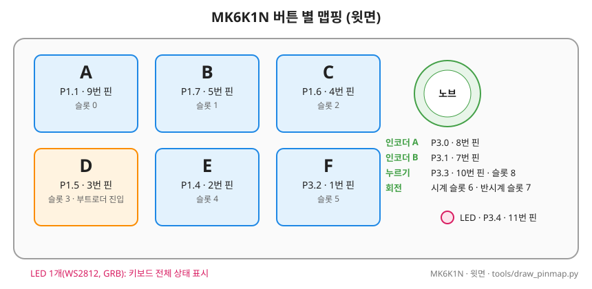
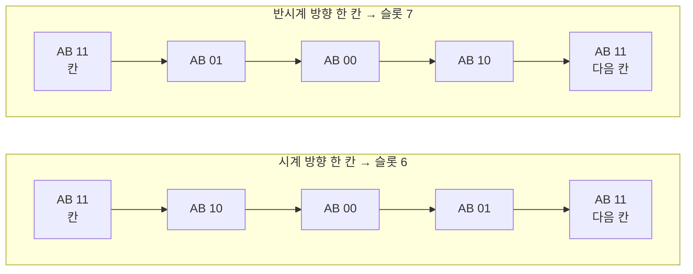
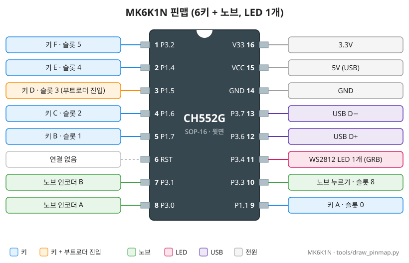

# MK6K1N 보드 (6키 + 노브, LED 1개)

- 요약 표: [BOARDS.md](../BOARDS.md). 키마다 LED인 같은 기판: [MK6K1NL](BOARD_MK6K1NL.md). 문서 양식: [_TEMPLATE.md](_TEMPLATE.md)

## 1. 개요

- 제품: 6키 + 노브 CH552G 미니 매크로 키보드
- 칩: **CH552G** (SOP-16), ROM 부트로더 2.5.0. 특성: [CHIPS.md](../CHIPS.md#칩-특성-표)
- 구성: 2×3 키(A~F) + 노브 1개(돌리기 양방향 + 누르기), WS2812 LED 1개
- 개발 보드 UID: 기록 없음 (칩 고유 ID는 HELLO 32~35, GUI 업데이트 창에 표시)
- 확인 근거: [test_pinmap](../../tests/hw/mk6k1n/test_pinmap/README.md) (2026-10-25)
- 표기
  - 핀 번호: 칩의 물리 핀 번호(1~16)
  - `P1.1` 등: GPIO 이름
  - 펌웨어 코드의 핀 번호: CH55xDuino 방식(`포트 × 10 + 비트`, 예: P1.5 = `15`)

## 2. 버튼 배치와 매핑

<!-- gen:pins-MK6K1N -->
| 키 | 핀 | LED 체인 위치 |
|---|---|---|
| A | P1.1 | - |
| B | P1.7 | - |
| C | P1.6 | - |
| D (업데이트 진입) | P1.5 | - |
| E | P1.4 | - |
| F | P3.2 | - |

| 기능 | 핀 |
|---|---|
| 노브 누르기 | P3.3 |
| 노브 A | P3.0 |
| 노브 B | P3.1 |
| LED (WS2812, GRB) | P3.4, 8자리 |
<!-- /gen:pins-MK6K1N -->

- 표는 `tools/gen_docs.py`가 보드 파일에서 만듦
- 슬롯: A~F = 0~5, 노브 시계 방향 6, 반시계 방향 7, 누르기 8
- 칩 핀 번호: A 9, B 5, C 4, D 3, E 2, F 1, 노브 A 8, 노브 B 7, 노브 누르기 10, LED 11 (3절)
- 펌웨어 이름: `PIN_KEY_A`(11), `PIN_KEY_B`(17), `PIN_KEY_C`(16), `PIN_KEY_D`(15), `PIN_KEY_E`(14), `PIN_KEY_F`(32), `PIN_ENC_A`(30), `PIN_ENC_B`(31), `PIN_KNOB_SW`(33), `PIN_LED`(34)
- 키 D(P1.5)는 ROM 부트로더 진입 핀
- 키와 노브 스위치는 누르면 GND에 붙음. 펌웨어는 칩 안의 풀업을 켜서 읽음(누르면 0)
- 키 A~E는 P1, 키 F·노브는 P3에 있음. 펌웨어는 포트를 직접 읽으므로 기판 파일이 이 배치를 `#error`로 검사함
- LED는 키와 따로 1개 (4절)

### 노브 신호

- 노브(로터리 인코더)는 한 칸(딸깍)마다 A·B 두 선이 4단계를 거침
- 칸에서 쉴 때는 두 선 모두 높음(`11`)

- 한 칸 판정: `11`로 돌아올 때 **같은 방향으로 2단계 이상** 움직였으면 한 칸으로 셈
  - 노브가 칸 사이(`10`)에 걸쳐 있을 때 옆 키를 누르는 흔들림으로 `10 ↔ 11`이 한 번 오가는 것은 안 셈
- 이 보드는 시계 방향이 디코더 기준 음수 방향 → 펌웨어가 방향을 뒤집어 읽음(test_pinmap에서 확인)

**이력**

- v1.5.0: 한 칸 판정을 "같은 방향 2단계 이상"으로 (전에는 한 단계 흔들림도 회전으로 셈, [TROUBLESHOOTING 3-6](../TROUBLESHOOTING.md#3-6-키-c를-누르면-ccwcw가-입력됨-mk6k1nl-v150-이전-빌드))

## 3. 칩 핀맵

- 칩 윗면, 위쪽 홈 왼쪽이 1번 핀. MK6K1N·MK6K1NL 공통 그림: [pinmap_ch552g.svg](../images/pinmap_ch552g.svg)

| 핀 번호 | 이름 | 용도 | 비고 |
|---|---|---|---|
| 1 | P3.2 | 키 F | |
| 2 | P1.4 | 키 E | |
| 3 | **P1.5** | 키 D | **ROM 부트로더 진입 핀** |
| 4 | P1.6 | 키 C | |
| 5 | P1.7 | 키 B | |
| 6 | RST | 연결 없음 | |
| 7 | P3.1 | 노브 인코더 B | |
| 8 | P3.0 | 노브 인코더 A | |
| 9 | P1.1 | 키 A | |
| 10 | P3.3 | 노브 누르기 | |
| 11 | P3.4 | WS2812 LED 데이터 (GRB) | `PIN_LED` (34) |
| 12 / 13 | P3.6 / P3.7 | USB D+ / D− | |
| 14 | GND | GND | |
| 15 | VCC | 5V (USB) | |
| 16 | V33 | 3.3V | 칩 내부 레귤레이터의 3.3V 출력 |

- 남는 GPIO 없음 → MK6K1NL의 LED 6개도 P3.4 하나에 **체인(직렬)으로** 이어짐

## 4. LED

- WS2812 1개, P3.4 (GRB)
- LED가 체인의 몇 번째인지 확인 안 함 → 펌웨어는 같은 색을 **8자리에** 보냄(`BOARD_LED_COUNT 8`, `BOARD_KEY_LEDS 0`, [TROUBLESHOOTING 3-4](../TROUBLESHOOTING.md))
- LED 하나가 키보드 전체 상태를 보여 줌([MANUAL LED 색 요약](../MANUAL.md#led-색-요약))
- 꽂을 때 LED 점검: 색 바퀴(빨강→노랑→초록→청록→파랑→보라→빨강)를 한 바퀴 3초씩 2번 → 0.3초 꺼짐 → 파랑 (약 6.3초, `BOARD_LED_SELF_TEST`). 그동안 키 입력은 되지만 키 LED 표시는 없음

**이력**

- 2026-11-07 (1.7.0): 꽂을 때 색 바퀴 점검 (전에는 CH32V203 보드만)

## 5. 부팅·장입

- WCH ROM 부트로더. 펌웨어를 올릴 때 진입 핀을 P1.5로 기록(`vnproch55x -c 1`) → **키 D를 누른 채 꽂으면** 업데이트 모드
- 제조사 펌웨어에서: **키 E를 누른 채 꽂기**(제조사 펌웨어의 기능)
- 진입 핀 설정이 P3.6이 되면 **12번(D+)–16번(3V3) 사이에 1.5~2kΩ**을 대고 꽂아야 함([TROUBLESHOOTING 2-3](../TROUBLESHOOTING.md#2-3-다운로드-실패-후-장치가-전혀-인식되지-않음-복구))
- 절차: [MANUAL 8장](../MANUAL.md#8-펌웨어-업데이트)

## 6. 본 펌웨어에서의 동작

- 보드 파일: `src/boards/mk6k1n.h` (공통 핀은 기판 파일 `src/boards/ch552_6k1n.h`, MK6K1NL과 같이 씀)
- 빌드: `tools\build_fw.ps1` (기본 보드) → `firmware/macro_keyboard/build/macro_keyboard-MK6K1N.hex`
- 슬롯 9개: 키 A~F + 노브 시계/반시계/누르기
- 패턴 입력 시작: 노브 2초

## 7. 확인 결과

| 항목 | 상태 |
|---|---|
| 키 6개, 노브, LED 핀 | 확인 (test_pinmap, 2026-10-25) |
| 본 펌웨어 v1.0~v1.6 | 실제 장치에서 동작 확인 (2026-10-26~) |
| 칩 고유 ID = 부트로더 ID | 확인 (ROM `0x3FFC`~`0x3FFF`, [BOARD_INFO.md](../BOARD_INFO.md)) |
