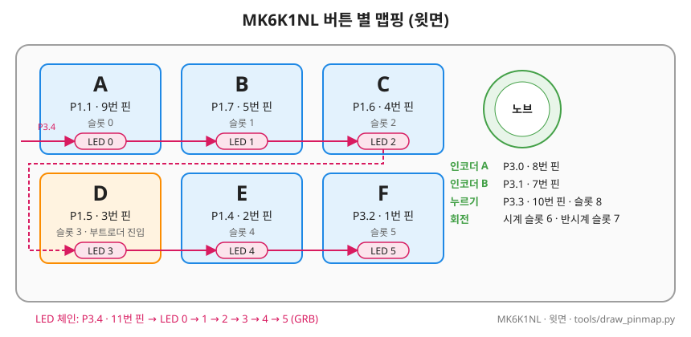
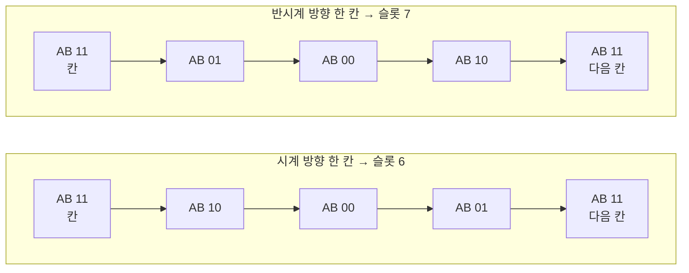
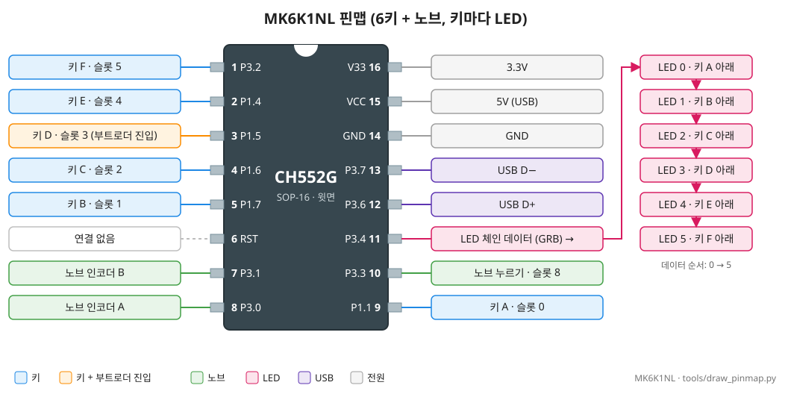

# MK6K1NL 보드 (6키 + 노브, 키마다 LED)

- 요약 표: [BOARDS.md](../BOARDS.md). 문서 양식: [_TEMPLATE.md](_TEMPLATE.md)

## 1. 개요

- 제품: 6키 + 노브 CH552G 미니 매크로 키보드, 키마다 LED
- PCB 표기 P/N: `ANXIN-K6-VT1-LED-V01`
- 이름: **MK6K1NL**. 옛 이름 **MK6K1N**(별칭): 같은 기판을 "LED 1개" 보드로 잘못 보고 따로 부르던 이름 (2026-11-17 MK6K1NL로 통일, 사용자 결정)
- 칩: **CH552G** (SOP-16), ROM 부트로더 2.5.0. 특성: [CHIPS.md](../CHIPS.md#칩-특성-표)
- 구성: 2×3 키(A~F) + 노브 1개(돌리기 양방향 + 누르기), **키마다 WS2812 LED**(6개, 체인 하나)
- 개발 보드 UID (칩 고유 ID, `check_device` 표시, HELLO 32~35)
  - `7D-E2-0F-BD` (`7de20fbd`): 옛 MK6K1N 문서의 개발 보드. 기록은 7절에 모음
  - `9C-B3-6E-BF` (`9cb36ebf`): 1.7.0 확인 개체. 공장 펌웨어 USB ID `1189:8890`
  - `5E-E0-6E-BF`: 첫 MK6K1NL 장치
- 확인 근거: [test_pinmap](../../tests/hw/mk6k1n/test_pinmap/README.md) (2026-10-25, 키·노브·LED 핀, UID `7de20fbd`), [test_mk6k1nl](../../tests/hw/mk6k1nl/test_mk6k1nl/README.md) (2026-10-31, LED 체인 순서·색 순서)
- 표기
  - 핀 번호: 칩의 물리 핀 번호(1~16)
  - `P1.1` 등: GPIO 이름
  - 펌웨어 코드의 핀 번호: CH55xDuino 방식(`포트 × 10 + 비트`, 예: P1.5 = `15`)

### MK6K1N과 MK6K1NL로 나눠 불렀던 까닭 (판단 근거)

- "LED 1개"로 본 까닭: UID `7de20fbd`를 test_pinmap으로 볼 때 LED가 체인 몇 번째인지 확인하지 않고 **8자리에 같은 색**을 보냄 → LED 6개가 늘 같은 색으로 켜져 상태 LED 하나처럼 보임
  - 그 판단으로 만든 MK6K1N 펌웨어(`BOARD_LED_COUNT 8`, `BOARD_KEY_LEDS 0`)도 6개를 같은 색으로만 켬 → 2026-11-17까지 잘못 알아채지 못함
  - 2026-11-17: `7de20fbd`에 MK6K1NL 펌웨어를 올리자 누른 키만 초록 → 키마다 LED인 같은 기판으로 확인
- 공장 펌웨어 때의 업데이트 모드 진입 차이: `7de20fbd`는 키 E를 누른 채 꽂기로 진입, `9cb36ebf`(`1189:8890`)는 키로 안 들어감 → 기판 차이가 아니라 **공장 펌웨어 판 차이**로 보임(추정, 공장 펌웨어가 지워져 확인 불가)
- 교훈: LED는 체인 위치마다 하나씩 켜 보고 개수·순서를 기록([NEW_BOARD.md](../NEW_BOARD.md))

**이력**

- 2026-11-17: MK6K1N 문서를 이 문서로 합침, PCB P/N, 옛 이름 MK6K1N(별칭), 판단 근거

## 2. 버튼 배치와 매핑

<!-- gen:pins-MK6K1NL -->
| 키 | 핀 | LED 체인 위치 |
|---|---|---|
| A | P1.1 | 0 |
| B | P1.7 | 1 |
| C | P1.6 | 2 |
| D (업데이트 진입) | P1.5 | 3 |
| E | P1.4 | 4 |
| F | P3.2 | 5 |

| 기능 | 핀 |
|---|---|
| 노브 누르기 | P3.3 |
| 노브 A | P3.0 |
| 노브 B | P3.1 |
| LED (WS2812, GRB) | P3.4, 6자리 |
<!-- /gen:pins-MK6K1NL -->
- 표는 `tools/gen_docs.py`가 보드 파일에서 만듦
- 슬롯: A~F = 0~5, 노브 시계 방향 6, 반시계 방향 7, 누르기 8
- 칩 핀 번호: A 9, B 5, C 4, D 3, E 2, F 1, 노브 A 8, 노브 B 7, 노브 누르기 10, LED 11 (3절)
- 펌웨어 이름: `PIN_KEY_A`(11), `PIN_KEY_B`(17), `PIN_KEY_C`(16), `PIN_KEY_D`(15), `PIN_KEY_E`(14), `PIN_KEY_F`(32), `PIN_ENC_A`(30), `PIN_ENC_B`(31), `PIN_KNOB_SW`(33), `PIN_LED`(34)
- 키 D(P1.5)는 ROM 부트로더 진입 핀
- 키와 노브 스위치는 누르면 GND에 붙음. 펌웨어는 칩 안의 풀업을 켜서 읽음(누르면 0)
- 키 A~E는 P1, 키 F·노브는 P3에 있음. 펌웨어는 포트를 직접 읽으므로 기판 파일이 이 배치를 `#error`로 검사함
- LED 체인 위치 i = 키 i 아래 LED (4절)

### 노브 신호

- 노브(로터리 인코더)는 한 칸(딸깍)마다 A·B 두 선이 4단계를 거침
- 칸에서 쉴 때는 두 선 모두 높음(`11`)

- 한 칸 판정: `11`로 돌아올 때 **같은 방향으로 2단계 이상** 움직였으면 한 칸으로 셈
  - 노브가 칸 사이(`10`)에 걸쳐 있을 때 옆 키를 누르는 흔들림으로 `10 ↔ 11`이 한 번 오가는 것은 안 셈
- 이 보드는 시계 방향이 디코더 기준 음수 방향 → 펌웨어가 방향을 뒤집어 읽음(test_pinmap에서 확인)

**이력**

- v1.5.0: 한 칸 판정을 "같은 방향 2단계 이상"으로 (전에는 한 단계 흔들림도 회전으로 셈, [TROUBLESHOOTING 3-6](../TROUBLESHOOTING.md#3-6-키-c를-누르면-ccwcw가-입력됨-mk6k1nl-v150-이전-빌드))

## 3. 칩 핀맵

- 칩 윗면, 위쪽 홈 왼쪽이 1번 핀. 칩만 그린 그림: [pinmap_ch552g.svg](../images/pinmap_ch552g.svg)

| 핀 번호 | 이름 | 용도 | 비고 |
|---|---|---|---|
| 1 | P3.2 | 키 F | |
| 2 | P1.4 | 키 E | |
| 3 | **P1.5** | 키 D | **ROM 부트로더 진입 핀** |
| 4 | P1.6 | 키 C | |
| 5 | P1.7 | 키 B | |
| 6 | RST | 연결 없음 | |
| 7 | P3.1 | 노브 인코더 B | |
| 8 | P3.0 | 노브 인코더 A | |
| 9 | P1.1 | 키 A | |
| 10 | P3.3 | 노브 누르기 | |
| 11 | P3.4 | WS2812 LED 체인 데이터 (GRB) | `PIN_LED` (34). LED 0(키 A) → … → LED 5(키 F) |
| 12 / 13 | P3.6 / P3.7 | USB D+ / D− | |
| 14 | GND | GND | |
| 15 | VCC | 5V (USB) | |
| 16 | V33 | 3.3V | 칩 내부 레귤레이터의 3.3V 출력 |

- 남는 GPIO 없음 → LED 6개는 P3.4 하나에 **체인(직렬)으로** 이어짐

## 4. LED

- **키마다 LED 하나**. P3.4에서 시작해 A → B → C → D → E → F 순서로 이어짐

| 순서 | 키 | 비고 |
|---|---|---|
| 0 | A | P3.4에 바로 이어짐 |
| 1~5 | B~F | 앞 LED의 출력에 이어짐 |

- 펌웨어 설정: `BOARD_LED_COUNT 6`, `BOARD_KEY_LEDS 1`(LED i는 키 i 아래)
- LED 표시:

| 상태 | 표시 |
|---|---|
| 사용 가능 | 6개 모두 파랑. 키를 누르는 동안 **그 키만 초록, 나머지 5개는 꺼짐**(노브를 누르는 동안·돌릴 때는 6개 모두 초록) |
| 패턴 입력 중 | 6개 모두 빨강. 키를 누르면 **그 키만 0.15초 꺼짐**(노브는 6개 모두) |
| 잠김·차단·저장·업데이트 모드 | 6개가 같은 색([MANUAL LED 색 요약](../MANUAL.md#led-색-요약)) |

- 꽂을 때 LED 점검 (`BOARD_LED_SELF_TEST`): 약 6.3초, 그 뒤 파랑. 그동안 키 입력은 되지만 키 LED 표시는 없음
  - 빛 하나가 둘레를 A부터 시계방향으로 흐름. 순서 A, B, C, F, E, D (`BOARD_LED_RING`), 한 바퀴 1초
  - 이웃한 두 칸 교차 페이드: 현재 칸이 어두워지는 동안 다음 칸이 밝아짐, 나머지 칸은 꺼짐
  - 빛의 색: 색 바퀴(빨강→노랑→초록→청록→파랑→보라→빨강)를 3초 주기로 2번
  - 끝나면 0.3초 꺼짐
  - 빌드 옵션: 보드 헤더의 `BOARD_LED_RING_CHASE 0`이면 무지개 회전(모든 칸이 켜진 채 색이 시계방향으로 이동)

- 옛 MK6K1N 펌웨어(`BOARD_LED_COUNT 8`, `BOARD_KEY_LEDS 0`)를 올리면 6개가 늘 같은 색 → MK6K1NL 펌웨어로 다시 장입(1절 판단 근거)

**이력**

- v1.5: 키별 LED(누른 키만 초록). v1.6.0: 패턴 입력 중 누른 키만 잠깐 꺼짐
- 2026-11-07: 초록 = 키를 누르는 동안(전에는 출력하는 동안)
- 2026-11-07: 누르는 동안 나머지 LED 꺼짐(전에는 파랑)
- 2026-11-07 (1.7.0): 꽂을 때 색 바퀴 점검 (전에는 CH32V203 보드만)
- 2026-11-10: LED 점검이 둘레를 흐르는 빛으로 회전, 이웃한 두 칸 교차 페이드 (전에는 모든 LED가 같은 색 바퀴)

## 5. 부팅·장입

- WCH ROM 부트로더. 펌웨어를 올릴 때 진입 핀을 P1.5로 기록(`vnproch55x -c 1`) → 우리 펌웨어가 있으면 **키 D**(P1.5)를 누른 채 꽂으면 업데이트 모드
  - 장입 프로그램(GUI 업데이트 창, `tools/flash.ps1`)을 먼저 띄운 뒤 키 D를 누른 채 꽂기. ROM 부트로더는 수 초 뒤 앱으로 빠져나감([TROUBLESHOOTING 2-2](../TROUBLESHOOTING.md#2-2-부트로더가-약-5초-만에-사라짐)). UID `7de20fbd`에서 이 순서로 진입·장입됨(1.7.2 장입 때 확인, 2026-11-17)
  - 키 D로 안 되면: 잠금을 풀고 GUI **[업데이트 모드로 전환]** ([MANUAL 8장](../MANUAL.md#8-펌웨어-업데이트)). 앞선 2회 실패(2026-11-17, 1.7.1 장입 전)는 타이밍 탓: 장입 시작(12초 뒤) 전에 부트로더가 빠져나감
  - LED 6개가 늘 같은 색이면 옛 MK6K1N 펌웨어가 들어 있는 것 → `macro_keyboard-MK6K1NL.hex`로 다시 장입
- 진입 핀 설정이 P3.6이 되면 **12번(D+)–16번(3V3) 사이에 1.5~2kΩ**을 대고 꽂아야 함([TROUBLESHOOTING 2-3](../TROUBLESHOOTING.md#2-3-다운로드-실패-후-장치가-전혀-인식되지-않음-복구))
- 공장 펌웨어에서 (판마다 다름, 1절 판단 근거)
  - UID `7de20fbd`: **키 E를 누른 채 꽂기**(공장 펌웨어의 기능)
  - UID `9cb36ebf`(USB ID `1189:8890`): **키로 업데이트 모드에 안 들어감** → 처음 한 번은 **D+ 풀업**(12번–16번, 1.5~2kΩ)으로 들어가서 올림 ([TROUBLESHOOTING 3-7](../TROUBLESHOOTING.md#3-7-mk6k1nl-제조사-펌웨어에서-업데이트-모드로-들어가지-않음))
  - GUI 펌웨어 업데이트 창은 공장 펌웨어를 식별 못 함 → **장입할 보드**에서 MK6K1NL 선택([MANUAL 8장](../MANUAL.md#8-펌웨어-업데이트))
- 절차: [MANUAL 8장](../MANUAL.md#8-펌웨어-업데이트)

**이력**

- 2026-11-17: 키 D로 안 될 때 BOOT 명령, MK6K1N 펌웨어가 들어 있을 때 증상
- 2026-11-17: 키 D 진입은 장입 프로그램을 먼저 띄운 뒤 꽂기(앞선 실패는 타이밍 탓)
- 2026-11-17: 옛 MK6K1N 문서의 진입 방법(키 E, P3.6 풀업)을 합침

## 6. 본 펌웨어에서의 동작

- 보드 파일: `src/boards/mk6k1nl.h` (공통 핀은 기판 파일 `src/boards/ch552_6k1n.h`)
- 빌드: `tools\build_fw.ps1 -Board mk6k1nl`(기본 보드라 `-Board` 생략도 같음) → `macro_keyboard-MK6K1NL.hex`
- 옛 MK6K1N 빌드(`mk6k1n.h`, LED 8자리에 같은 색)는 없어짐(2026-11-17). 옛 펌웨어가 든 키보드는 GUI가 HELLO 이름 `MK6K1N`을 별칭으로 MK6K1NL로 인식해 그대로 업데이트 가능
- 슬롯 9개: 키 A~F + 노브 시계/반시계/누르기
- 패턴 입력 시작: 노브 2초

**이력**

- 2026-11-17: MK6K1N 빌드 대상 없앰(MK6K1NL로 통합), 옛 이름은 GUI 별칭

## 7. 확인 결과

| 항목 | 상태 |
|---|---|
| 키 6개, 노브, LED 핀 | 확인 (test_pinmap, UID `7de20fbd`, 2026-10-25) |
| LED 체인 순서 A→F, 색 순서 | 확인 (test_mk6k1nl, 2026-10-31) |
| 칩 고유 ID = 부트로더 ID | 확인 (ROM `0x3FFC`~`0x3FFF`, [BOARD_INFO.md](../BOARD_INFO.md)) |

- UID `7de20fbd` (옛 MK6K1N 문서의 개발 보드)

| 항목 | 상태 |
|---|---|
| 본 펌웨어 v1.0~v1.6 (MK6K1N 펌웨어) | 실제 장치에서 동작 확인 (2026-10-26~). LED는 6개가 같은 색 |
| 본 펌웨어 1.7.0 장입 (MK6K1N 펌웨어) | `tools/flash.ps1`(vnproch55x, 부트로더 2.5.0, ID `7D E2 0F BD`), 쓰기·검증 성공 (2026-11-09) |
| 본 펌웨어 1.7.0 점검 (MK6K1N 펌웨어) | `check_device` 통과: v1.7.0, 프로토콜 v2, 슬롯 9, 용량 128바이트, 보드 MK6K1N, 설정 유효(채워진 슬롯 9개, 패턴 암호 있음) (2026-11-09) |
| 본 펌웨어 1.7.0 눈 확인 (MK6K1N 펌웨어) | 정상: 꽂을 때 색 바퀴, 패턴으로 잠금 해제, 키를 누르는 동안 초록(최소 약 0.2초), 노브 회전 시 약 0.2초 초록, 저장한 문자열 입력(설정 유지) (2026-11-09, 사용자). LED 6개가 늘 같은 색이었음 |
| 잘못된 펌웨어 | MK6K1NL 기판에 MK6K1N 펌웨어 v1.7.0이 들어 있어 LED 6개가 늘 같은 색이었음 (2026-11-17) |
| 본 펌웨어 1.7.1 장입 | `macro_keyboard-MK6K1NL.hex`, vnproch55x 쓰기·검증 성공. HELLO MK6K1NL v1.7.1, 설정 유지(슬롯 9개, 패턴 암호) (2026-11-17) |
| 장입 직후 인식 오류 | 장입("Reset OK", 칩 스스로 다시 시작) 뒤 잠금을 풀자 장치 인식 오류(장치 관리자 "장치 설명자 요청 실패", 코드 43). 뽑았다 다시 꽂으니 정상 (2026-11-17, 사용자, 08:09쯤 한 번 더 겪음). 원인 추정: 켤 때 USB 재열거를 하지 않음, 1.7.2에서 고침([TROUBLESHOOTING 2-9](../TROUBLESHOOTING.md#2-9-ch552-장입-직후-장치-인식-오류)) |
| 본 펌웨어 1.7.1 눈 확인 | 정상: 꽂을 때 둘레를 도는 빛, 누른 키만 초록, 문자열 입력 (2026-11-17, 사용자 "잘 돼") |
| 본 펌웨어 1.7.2 장입 | 키 D 진입, vnproch55x Verify complete·Reset OK. 칩 스스로 다시 시작 뒤 코드 43 없이 HELLO MK6K1NL v1.7.2, 설정 유지(슬롯 9개, 패턴 암호). 패턴으로 잠금 푼 뒤에도 READ 정상, 장치 관리자 오류 장치 없음 (2026-11-17). 앱 10,540 B |
| 업데이트 모드 진입(키 D) | 장입 프로그램을 먼저 띄운 뒤 키 D(P1.5)를 누른 채 꽂으면 진입·장입됨(1.7.2 장입 때 확인, 2026-11-17). 앞선 2회 실패(1.7.1 장입 전)는 타이밍 탓: 1회는 진입 흔적 없음, 2회째는 ROM 부트로더(`4348:55E0`)가 잠깐 잡혔으나 12초 뒤 장입 시작 때 없었음(부트로더 수 초 뒤 종료). 그때는 잠금 풀고 BOOT 명령으로 장입 |

- UID `9cb36ebf`

| 항목 | 상태 |
|---|---|
| 본 펌웨어 v1.5~v1.6 | 실제 장치에서 동작 확인 |
| 본 펌웨어 1.7.0 장입 | `tools/flash.ps1`(vnproch55x, 부트로더 2.5.0, ID `9C B3 6E BF`), 쓰기·검증 성공 (2026-11-09) |
| 본 펌웨어 1.7.0 점검 | `check_device` 통과: v1.7.0, 프로토콜 v2, 슬롯 9, 용량 128바이트, 보드 MK6K1NL, 설정 유효(채워진 슬롯 9개, 패턴 암호 없음) (2026-11-09) |
| 본 펌웨어 1.7.0 눈 확인 | 정상: 꽂을 때 색 바퀴, 키를 누르는 동안 누른 키의 LED만 초록이고 나머지는 꺼짐(최소 약 0.2초), 노브 회전 시 약 0.2초 초록, 저장한 문자열 입력(설정 유지) (2026-11-09, 사용자) |

**이력**

- 2026-11-17: UID `7de20fbd` 1.7.1 장입·눈 확인, 키 D로 장입 못 함(2회째는 부트로더가 잠깐 잡힘), 장입 직후 인식 오류(다시 꽂아 해결)
- 2026-11-17: UID `7de20fbd` 1.7.2 장입(키 D 진입), 장입 뒤 인식 오류 없음
- 2026-11-17: 옛 MK6K1N 문서의 확인 기록(UID `7de20fbd`)을 합쳐 UID별로 나눔
