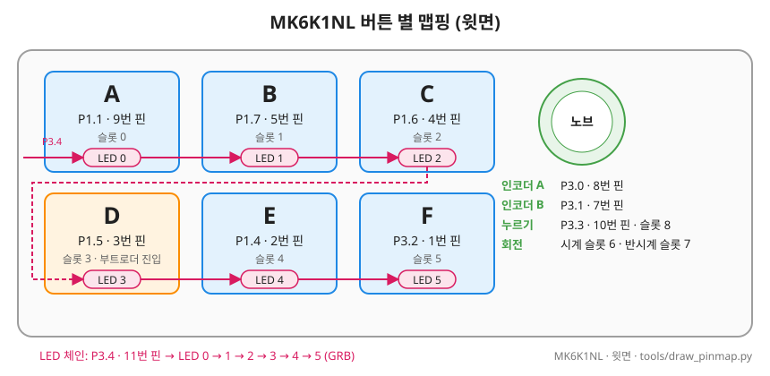
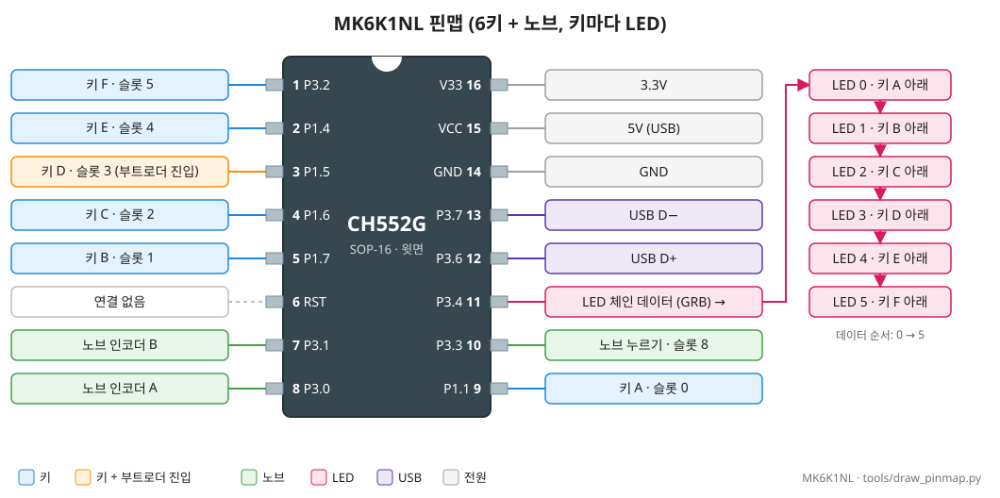

# MK6K1NL 보드 (6키 + 노브, 키마다 LED)

- 요약 표: [BOARDS.md](../BOARDS.md). 같은 기판의 LED 1개 판: [MK6K1N](BOARD_MK6K1N.md)

## 1. 개요

- 칩: **CH552G** (MK6K1N과 같음)
- 구성: 2×3 키(A~F) + 노브 1개, **키마다 WS2812 LED**(6개)
- 보드 파일: `src/boards/mk6k1nl.h` (공통 핀은 `src/boards/ch552_6k1n.h`)
- 이름: MK6K1N과 키 수가 같고 기판이 다름 → 끝에 `L`(키마다 LED)
- 확인 근거: [test_mk6k1nl](../../tests/hw/mk6k1nl/test_mk6k1nl/README.md) (2026-10-31)
- 첫 장치: 칩 고유 ID `5E-E0-6E-BF`, 부트로더 2.5.0

## 2. 키 배치

- 키·노브 핀은 MK6K1N과 같음: [BOARD_MK6K1N.md](BOARD_MK6K1N.md) "CH552G 핀", "노브 신호"

### 버튼 별 맵핑

### 핀맵

## 3. LED

- **키마다 LED 하나**. P3.4에서 시작해 A → B → C → D → E → F 순서로 이어짐
- 펌웨어 설정: `BOARD_LED_COUNT 6`, `BOARD_KEY_LEDS 1`(LED i는 키 i 아래)
- LED 표시:

| 상태 | 표시 |
|---|---|
| 사용 가능 | 6개 모두 파랑. 키를 누르는 동안 **그 키만 초록, 나머지 5개는 꺼짐**(노브를 누르는 동안·돌릴 때는 6개 모두 초록) |
| 패턴 입력 중 | 6개 모두 빨강. 키를 누르면 **그 키만 0.15초 꺼짐**(노브는 6개 모두) |
| 잠김·차단·저장·업데이트 모드 | 6개가 같은 색([MANUAL LED 색 요약](../MANUAL.md#led-색-요약)) |

- 꽂을 때 LED 점검: 색 바퀴(빨강→노랑→초록→청록→파랑→보라→빨강)를 한 바퀴 3초씩 2번 → 0.3초 꺼짐 → 파랑 (약 6.3초, `BOARD_LED_SELF_TEST`). 그동안 키 입력은 되지만 키 LED 표시는 없음

**이력**

- v1.5: 키별 LED(누른 키만 초록). v1.6.0: 패턴 입력 중 누른 키만 잠깐 꺼짐
- 2026-11-07: 초록 = 키를 누르는 동안(전에는 출력하는 동안)
- 2026-11-07: 누르는 동안 나머지 LED 꺼짐(전에는 파랑)
- 2026-11-07 (1.7.0): 꽂을 때 색 바퀴 점검 (전에는 CH32V203 보드만)

## 4. 부팅·장입

- 우리 펌웨어가 있으면 MK6K1N과 같음: **키 D**(P1.5)를 누른 채 꽂기 ([BOARD_MK6K1N.md](BOARD_MK6K1N.md) "부팅·장입")
- 제조사 펌웨어(USB ID `1189:8890`)에서는 **키로 업데이트 모드에 안 들어감**
  - 처음 한 번은 **D+ 풀업**(12번–16번, 1.5~2kΩ)으로 들어가서 올림 ([TROUBLESHOOTING 3-7](../TROUBLESHOOTING.md#3-7-mk6k1nl-제조사-펌웨어에서-업데이트-모드로-들어가지-않음))
  - GUI 펌웨어 업데이트 창은 이 키보드를 식별 못 함 → **장입할 보드**에서 MK6K1NL 선택([MANUAL 8장](../MANUAL.md#8-펌웨어-업데이트))

## 5. 본 펌웨어에서의 동작

- 빌드: `tools\build_fw.ps1 -Board mk6k1nl` → `macro_keyboard-MK6K1NL.hex`
- 키 수·슬롯·잠금은 MK6K1N과 같음. 다른 점은 LED 표시(위 3절)

## 6. 확인 결과

| 항목 | 상태 |
|---|---|
| 키·노브 핀 (MK6K1N과 같음) | 확인 (2026-10-31) |
| LED 체인 순서 A→F, 색 순서 | 확인 (test_mk6k1nl) |
| 본 펌웨어 v1.5~v1.6 | 실제 장치에서 동작 확인 |
