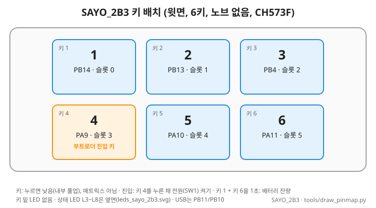
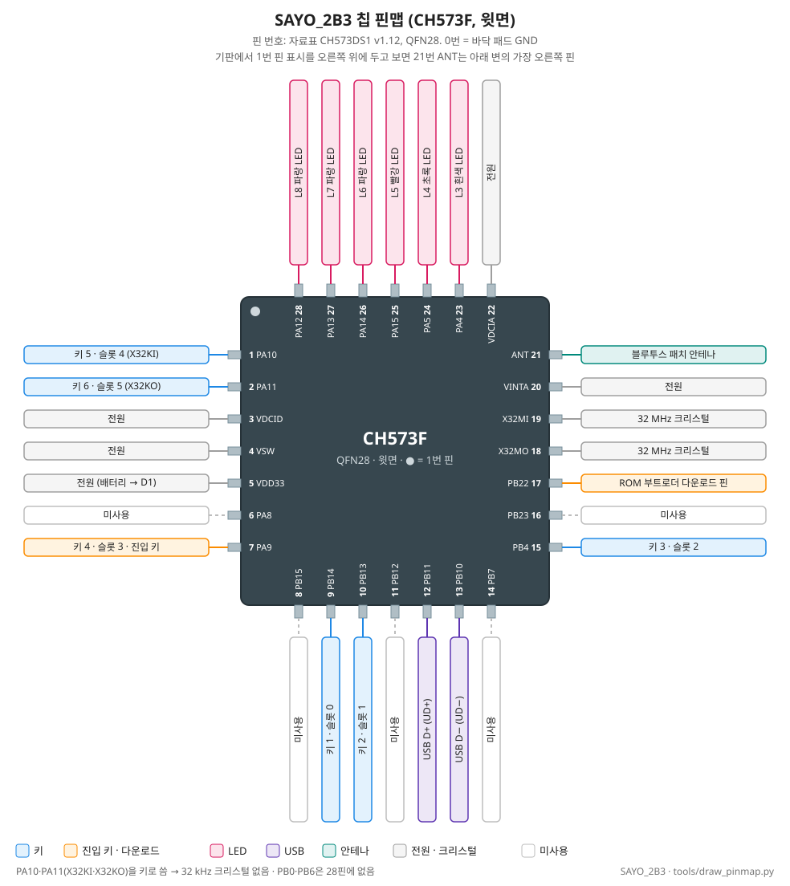
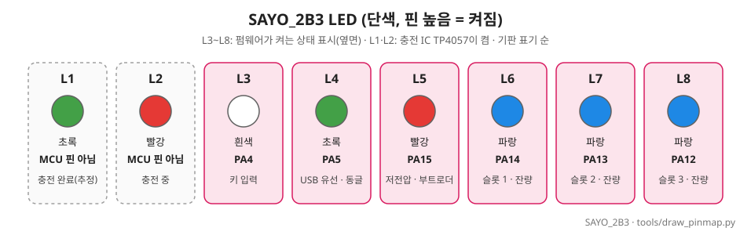

# SAYO_2X3B_RGB (6키, 블루투스)

- 요약 표: [BOARDS.md](../BOARDS.md#준비-중-보드). 같은 계열: [SAYO_3X3](BOARD_SAYO_3X3_RGB.md), [SAYO_2X4](BOARD_SAYO_2X4_RGB.md), [SAYO_2X6](BOARD_SAYO_2X6_RGB.md). 문서 양식: [_TEMPLATE.md](_TEMPLATE.md)

## 1. 개요

- 제품: SayoDevice 6키 블루투스 매크로 키보드 (동글 USB 문자열 "SayoDevice 2x3B" 근거. 정식 제품명 확인 필요)
- 보드 ID(펌웨어·GUI·`-Board`): `SAYO_2B3` (8자, HELLO 이름 칸 8바이트. 2B3 = 2×3 블루투스). 문서 파일·제목은 `SAYO_2X3B_RGB`. 옛 이름 `BT_2X3`(`gui/core/boards.py` 이 보드의 `aliases`). 이름 규칙은 [NEW_BOARD 5절](../NEW_BOARD.md#5-보드-파일gui스크립트시험-추가)
- 기판 표기: `2x3M_BLE_Ver1.1` (사용자 관찰, 2026-11-13)
- 칩: WCH **CH573F** (QFN28). 칩 표기 둘째 줄 `1042FF04`는 로트 번호로 보임. 특성: [CHIPS.md](../CHIPS.md#칩-특성-표)
  - 단일 BLE SoC로 보임(별도 BLE 모듈 안 보임, 기판 사진으로 확정 필요). 블루투스 패치 안테나는 21번 ANT 핀(3절)
- 구성: 2×3 키(노브: 확인 필요), 옆면 상태 표시 단색 LED 6개(L3~L8) + 충전 표시 L1·L2(4절)
  - 무선: **별도 USB 동글**(CH582F, 5절 "동글"). 유선 USB도 됨
  - 전원 스위치 SW1, 배터리 Li-Po 1S, 충전 IC TP4057 (5절 "전원과 배터리")
- 개발 보드 UID: `1A-73-38-72-AB-3C-FD-21` (`wchisp info`·WCHISPTool, 2026-11-13). 자체 부트로더 HELLO의 UID는 이것과 다름(5절)
- 확인 근거: [test_ch573](../../tests/hw/ch573/test_ch573/README.md) 시험(KEYS·FIND·ADC, 2026-11-13), 사용자 관찰·측정, 자료표 CH573DS1 v1.12
- 상태: **준비 중**. 키·LED 핀·전원 확인, 자체 부트로더 설치·확인, 본 펌웨어 BLE 1단계(USB 유선 + BLE HID, 본딩 1대) 기판 확인(2026-11-14). GUI 보드 목록 등록. 슬롯 3개·동글 연결·GUI 설정 확인 전
- 블루투스 보드 주의·파일 위치: [NEW_BOARD.md 9절](../NEW_BOARD.md#9-식별-전-보드). 공장 시절 식별 기록: 부록

**이력**

- 2026-11-13: 이름 `BT_2X3` → `SAYO_2B3`(사용자 결정, HELLO 이름 칸 8자), 문서 파일 `BOARD_BT_2X3.md` → `BOARD_SAYO_2X3B_RGB.md`
- 2026-11-13: 문서를 양식(\_TEMPLATE)에 맞춤. 식별 체크리스트·연결 방식 확인은 부록으로

## 2. 버튼 배치와 매핑

<!-- gen:pins-SAYO_2B3 -->
| 키 | GPIO (누르면 Low, 내부 풀업) |
|---|---|
| 1 | PB14 |
| 2 | PB13 |
| 3 | PB4 |
| 4 (업데이트 진입) | PA9 |
| 5 | PA10 |
| 6 | PA11 |

상태 LED (High = 켜짐)

| LED | GPIO | 색 | 용도 |
|---|---|---|---|
| L3 | PA4 | 흰색 | 키 입력 |
| L4 | PA5 | 초록 | 동글·USB 케이블 |
| L5 | PA15 | 빨강 | 배터리 |
| L6 | PA14 | 파랑 | BLE 슬롯 1 |
| L7 | PA13 | 파랑 | BLE 슬롯 2 |
| L8 | PA12 | 파랑 | BLE 슬롯 3 |
<!-- /gen:pins-SAYO_2B3 -->

- 표는 `tools/gen_docs.py`가 보드 파일(`src/hal/ch573/sayo_2b3.h`)에서 만듦. L1·L2(충전 IC)는 4절
- 번호: 왼쪽 위부터 행 순서(1~3 윗줄, 4~6 아랫줄). 칩 핀 번호는 3절
- 키마다 핀 하나 + GND(매트릭스 아님), 누르면 낮음, 내부 풀업 (시험 펌웨어 KEYS, 2026-11-13)
- 진입 키: **키 4**(PA9, 왼쪽 아래, 다른 보드와 같은 자리). 기판에서 진입 확인(2026-11-13, 5절)
- 특수 핀: PA10·PA11 = 32 kHz 크리스털 핀(X32KI·X32KO)이지만 키 5·6으로 씀
- 슬롯 6개: 슬롯 = 키 번호 − 1 (노브 없음, [BOARD_INFO 1절](../BOARD_INFO.md#1-슬롯-번호-규칙-일반화))
- 켤 때 누른 키: 키 4 = 부트로더(5절), **키 5 = BLE 본딩 지우고 페어링**(6절), 키 6 = 2단계(슬롯 3개)용으로 비워 둠

**이력**

- 2026-11-13: 키 핀 6개 확인. 진입 키를 키 6(PA11)에서 키 4(PA9)로 바꿈(사용자 결정)
- 2026-11-15: 손으로 쓴 키 표를 생성 구역 `pins-SAYO_2B3`(키 + 상태 LED)로 바꿈

## 3. 칩 핀맵

- 핀 번호: 확인(자료표 WCH CH573DS1 v1.12, QFN28, 2026-11-13). 0번 = 바닥 패드(GND)

| 핀 번호 | 이름 | 용도 | 비고 |
|---|---|---|---|
| 1 / 2 | PA10 / PA11 | 키 5 / 6 | X32KI / X32KO. 32 kHz 크리스털 없음 |
| 7 | PA9 | 키 4 (진입 키) | |
| 9 / 10 | PB14 / PB13 | 키 1 / 2 | |
| 15 | PB4 | 키 3 | |
| 12 / 13 | PB11 / PB10 | USB D+ / D− | UD+ / UD− |
| 17 | PB22 | ROM 부트로더 다운로드 핀 | GND에 대고 SW1 켜기 → ROM 부트로더(5절). 키 아님 |
| 18 / 19 | X32MO / X32MI | 32 MHz 크리스털 | 크리스털 부품은 기판 확인 필요 |
| 21 | ANT | 블루투스 패치 안테나 | |
| 23 / 24 / 25 | PA4 / PA5 / PA15 | L3 흰색 / L4 초록 / L5 빨강 | 높음 = 켜짐 |
| 26 / 27 / 28 | PA14 / PA13 / PA12 | L6 / L7 / L8 파랑 | 높음 = 켜짐 |
| 6 | PA8 | 미사용 | AIN12. ADC로 연결 없음 확인 |
| 8 / 11 / 14 / 16 | PB15 / PB12 / PB7 / PB23 | 미사용 | 시험 펌웨어로 키·LED 아님 확인 |
| 5 | VDD33 | 칩 전원 | 배터리 → D1 뒤(5절) |
| 3 / 4 / 20 / 22 | VDCID / VSW / VINTA / VDCIA | 전원 핀 | 용도는 자료표 참고 |
| 0 | GND (바닥 패드) | GND | |

- PB0·PB6은 28핀에 없음(시험 펌웨어 핀 표에는 있으나 칩 밖으로 안 나옴)
- 32 kHz 크리스털 없음(PA10·PA11이 키) → BLE 저속 클록은 내부 LSI
- 안테나 핀 위치(사용자 관찰): 칩 윗면에서 1번 핀 표시 모서리를 **오른쪽 위**에 두었을 때, 오른쪽 아래 모서리 쪽 **아래 변의 가장 오른쪽 핀**

## 4. LED

- 방식: **단색 LED**, 핀 높음 = 켜짐(양극을 핀이 직접 구동, 음극 GND). WS2812·키별 LED 아님 (시험 펌웨어 FIND, 2026-11-13)
- 위치: L1~L8 모두 기판의 키 반대쪽. L3~L8은 키보드 옆면에서 보임 → **상태 표시용 6개**(사용자 관찰, 2026-11-13)
- 본 펌웨어는 LED 핀을 출력 낮음(꺼짐)으로 시작

| LED | 색 | 핀 | 비고 |
|---|---|---|---|
| L1 | 초록 | MCU 핀 아님 | 충전 IC가 켬. USB를 뽑으면 잠깐 켜짐(완충 표시로 추정) |
| L2 | 빨강 | MCU 핀 아님 | 충전 IC가 켬. USB를 꽂으면 켜짐(충전 중 표시로 보임) |
| L3 | 흰색 | PA4 | |
| L4 | 초록 | PA5 | |
| L5 | 빨강 | PA15 | |
| L6 | 파랑 | PA14 | 슬롯 1 |
| L7 | 파랑 | PA13 | 슬롯 2 |
| L8 | 파랑 | PA12 | 슬롯 3 |

- SW1을 켤 때 L3~L8이 잠깐 켜짐(공장 펌웨어, 2026-11-13). 공장 펌웨어의 연결 방식별 동작은 부록
- 시험 펌웨어 FIND 중에는 구동하지 않는 핀이 풀업이라 LED가 희미하게 켜짐 → 정상(높음 = 켜짐 구조의 근거)

### LED 의미

- **확정**(사용자 결정, 2026-11-13)
- 구현: `firmware/macro_keyboard/src/core/bt_led.c`(`BOARD_BT_LED` 보드만), 핀 구동 `src/hal/ch573/led_ch573.c`, host 시험 통과. 시간·값은 `bt_led.h` 상수
  - 본 펌웨어(6절)에 연결: 키 입력 흰색, USB 연결 초록, 저전압 빨강, 키 1+6 잔량 파랑, BLE 페어링·재연결·연결됨 = **L6 파랑**(BLE 1단계는 본딩 1대 = 슬롯 1만)
  - 슬롯 2·3(L7·L8), 슬롯 바꿈, 동글 초록은 2단계 → 지금은 시험 빌드(`DEMO=1`, 6절)로만 켬 → 기판에서 표시 확인(2026-11-13)
  - BLE 슬롯 파랑은 USB 연결 중에도 보임. 동글↔USB 전환 때는 초록만(슬롯 파랑이 끼어들지 않음)
  - 동시에 켜는 LED는 최대 3개(넘으면 낮은 우선순위부터 뺌)
  - 초록 L4(동글)도 페어링 0.2초·재연결 1초 깜빡임은 파랑과 같음
  - 키 입력 흰색은 끄기 플래그 있음(설정 연결은 나중), 잔량 표시는 2초
- 충전 IC TP4057이 켜는 LED(펌웨어 제어 아님): L2 빨강 = 충전 중, L1 = 충전 완료(추정)

| 상태 | LED |
|---|---|
| 페어링 대기 | 고른 슬롯의 파랑 빠르게 깜빡임(0.2초). 60초 뒤 광고 멈추면 꺼짐 |
| 재연결 중 | 고른 슬롯의 파랑 느리게 깜빡임(1초). 60초 뒤 광고 멈추면 꺼짐 |
| 연결됨 | 고른 슬롯의 파랑 3초 켜진 뒤 꺼짐 |
| 슬롯 바꿈 | 그 슬롯의 파랑 1초 |
| 동글 연결됨 | 초록 3초 뒤 꺼짐 |
| USB 유선 연결됨 | 초록 계속 켜짐 |
| 전압 부족(배터리 약 3.4 V 아래) | 빨강 5초마다 짧게 한 번 |
| 전압 매우 부족(약 3.1 V) | 빨강 빠르게 3번 뒤 절전 |
| 키 입력 | 흰색 30 ms 깜빡임(기본 켜짐, 나중에 설정으로 끌 수 있게 할 예정) |
| 배터리 잔량 확인 | 키 1 + 키 6을 함께 1초 → 파랑 개수: 3개 >66%, 2개 >33%, 1개 그 아래 |
| 부트로더 | 빨강 L5 깜빡임 |

- 배터리 전압은 내부 VBAT 채널로 추정(5절 "전원과 배터리")

**이력**

- 2026-11-13: LED 핀·색 확인(L5 빨강은 처음에 안 켜진 것으로 보였으나 다시 보니 켜짐). L1·L2는 MCU 핀 아님
- 2026-11-13: LED 의미 확정, `bt_led.c` 구현. 부트로더 표시는 "빨강 L5 깜빡임"으로 확정(구현 그대로)
- 2026-11-14: BLE 1단계에 페어링·재연결·연결됨(L6) 연결

## 5. 부팅·장입

- 평소 업데이트: **자체 HID 부트로더**. **키 4를 누른 채 SW1 켜기** 또는 앱의 BOOT 명령 → `hidboot` (아래 "자체 부트로더")
- 처음 설치·복구: ROM 부트로더. USB를 꽂은 채 **PB22를 GND에 대고 SW1 켜기** → `4348:55E0`(BTVER 02.90) → wchisp로 첫 설치 이미지(부트로더 + 앱). 절차: [BOOTLOADER_CH573.md](../BOOTLOADER_CH573.md#설치업데이트)
  - 키 1~6 중 PB22에 이어진 키는 없어 보임 → 점퍼로 GND에 댐
  - 통신이 없으면 약 6~15초 뒤 앱으로 돌아감
  - 다운로드 설정 핀: WCHISPTool 기본 PB22, PB11로도 바꿀 수 있음
  - 드라이버: ROM 부트로더에 WinUSB(Zadig) → wchisp 동작. CH375 드라이버면 wchisp가 못 엶(WCHISPTool은 됨)
- 전원: SW1이 꺼져 있으면 USB를 꽂아도 USB 장치로 안 잡힘 → 칩이 SW1 뒤 전원(아래 "전원과 배터리")
- `wchisp info` (2026-11-13, 읽기만)
  - 칩 CH573 (ID 0x7313), 플래시 448 KiB, 데이터 EEPROM 32 KiB, BTVER 02.90, UID `1A-73-38-72-AB-3C-FD-21`
  - `CFG_ROM_READ`=0 → 공장 펌웨어 **읽기 보호 켜짐**(백업 불가)
  - `DOWNLOAD_CFG` PB22, `CFG_BOOT_EN` 켜짐, `CFG_DEBUG_EN` 꺼짐, `CFG_RESET_EN` 꺼짐, `NO_KEY_SERIAL_DOWNLOAD` 켜짐
- 핀 시험 펌웨어: [test_ch573](../../tests/hw/ch573/test_ch573/README.md)
- ⚠️ 공장 펌웨어는 시험 펌웨어 장입으로 **지워짐**(동글 짝짓기 포함, 되돌릴 수 없음)

### 자체 부트로더 (CH573)

- 설계·빌드·사용법·문제 해결: [BOOTLOADER_CH573.md](../BOOTLOADER_CH573.md)
- `firmware/bootloader_ch573`, USB `1209:C55E`, 부트로더 0x0000(5,204 B) / 앱 정보 0x2000 / 앱 0x3000
- 진입: **키 4(PA9)를 누른 채 SW1 켜기**, 앱의 BOOT 명령, 앱 정보 없음·CRC 틀림. 머무는 동안 L5 빨강(PA15) 깜빡임
- 상태: **설치함·확인**: 키 4 진입 정상(Windows 코드 10 없음), `hidboot` info·flash(데모 앱 10,176 B)·run → 앱 `1209:C55D` 정상
  - 기판의 부트로더는 옛 이름 `BT_2X3`을 보고함 → `gui/core/boards.py` 이 보드의 `aliases`로 새 이름 앱도 통과(기판 확인: 부트로더가 `BT_2X3`을 보고하는 상태에서 `hidboot`로 SAYO_2B3 앱 129,464 B·129,792 B 장입 성공, 2026-11-13~14)
- 스크립트: `tools\flash.ps1 -Board sayo_2b3`(자체 부트로더, `-Enter` 가능), `-Full`(ROM 부트로더 + wchisp, UID가 1절 값이 아니면 멈춤). GUI 업데이트 창도 "SW1을 껐다가 키 4를 누른 채 켜세요" 안내
- HELLO의 칩 UID(ROM GET_UNIQUE_ID 값)는 `wchisp info` UID(1절)와 다름

### 동글 (CH582F)

- 동글 세부(핀, 장입, 우리 펌웨어 `1209:C55F`, 확인 결과): [BOARD_DONGLE_CH582.md](BOARD_DONGLE_CH582.md)
- 요약: 칩 CH582F, 버튼·LED·부트로더 패드 없음. 우리 펌웨어 `firmware/dongle_ch582`와 핀 시험 `tests/hw/ch582_dongle`은 빌드만, **미장입**. 첫 장입은 공장 짝짓기를 영구히 지움 → 사용자 승인 뒤
- ROM 부트로더 진입은 키보드와 같은 방식으로 추정(PB22 = 17번 핀, QFN28 배치가 CH573F와 같음)
- USB 포트가 충전 전용인 보드라면 장입·설정 방법부터 따로 정함 ([NEW_BOARD.md 9-2](../NEW_BOARD.md#9-2-블루투스-보드-주의))

### 전원과 배터리

- 확인 근거: 사용자 측정(멀티미터), 시험 펌웨어 ADC 모드, 2026-11-13. BLE 배터리 % 표시(90%) 기판 확인 2026-11-14
- 배터리 상태는 BLE 배터리 서비스와 설정 통신 명령 [`0x07` BATTERY](../PROTOCOL.md#0x07-battery)(%, mV, 케이블 꽂기 전 값, 케이블 연결 시간)로 알림
- USB 연결 중엔 충전 IC 때문에 값이 높게 나옴 → 펌웨어 상수 `BATTERY_CHARGE_MV`로 빼도록 함(지금 0, 케이블 꽂고 뺄 때 멀티미터와 비교해 정함, 확인 필요)
- 전원 경로: 배터리(Li-Po 1S) → D1 다이오드 → 칩 VDD33(5번 핀). **LDO 없음**
- 충전 IC: TP4057 (실크 `57bM`). L1(초록)·L2(빨강)는 충전 IC가 구동(4절)
- 칩 전압 범위(자료표): VDD33 2.3~3.6 V, 절대 최대 4.2 V → 배터리 약 3.0 V에서 칩 전원 2.3 V(하한)

| 측정 | 값 |
|---|---|
| 배터리 (멀티미터) | 4.167 V |
| D1 뒤 = 칩 전원 (멀티미터) | 3.46 V |
| D1 강하 | 0.711 V |
| ADC 내부 VBAT 채널 (같은 때) | 3,515~3,519 mV (멀티미터보다 약 +55 mV, 대략 보정 기준) |
| PA8·PB0·PB6 (ADC) | 약 2.75~2.8 V = 풀업 잔류 전압 → 연결 없음 |

- 결론: **내부 VBAT 채널로 배터리 전압 추정 가능**(배터리 ≈ VBAT + 약 0.65 V). 분압 저항 불필요
  - D1 강하는 전류·온도에 따라 바뀜 → 추정값은 대략값

**이력**

- 2026-11-13: ROM 부트로더 진입·`wchisp info`(읽기 보호 켜짐) 확인. 시험 펌웨어 장입(wchisp: 8섹터 지움, 7,168 B 쓰기, 검증 OK, `RST O`·`MODE: KEYS` 입력) → 공장 펌웨어 지워짐
- 2026-11-13: 자체 부트로더 설치. USB를 인터럽트 방식·모르는 GET_DESCRIPTOR 0 B 응답으로 고쳐 Windows 코드 10 해결
- 2026-11-13: 동글 펌웨어·동글 핀 시험 펌웨어 빌드(미장입). 전원·배터리 측정
- 2026-11-13: 동글 세부와 공장 동글 USB·HID 기록을 [BOARD_DONGLE_CH582.md](BOARD_DONGLE_CH582.md)로 옮기고 요약만 둠

## 6. 본 펌웨어에서의 동작

- 보드 파일: 앱 `firmware/macro_keyboard/src/hal/ch573/sayo_2b3.h`(CH573 HAL 옆, `src/boards` 밖), 부트로더 `firmware/bootloader_ch573/boards/sayo_2b3.h`
- 빌드: `tools\build_fw.ps1 -Board sayo_2b3` → `build/ch573/macro_keyboard-SAYO_2B3.bin`(129,464 B, BLE 라이브러리 포함), 자체 부트로더, 첫 설치 이미지 `…-full.bin`(`Makefile.ch573 full`)
  - 자체 부트로더 뒤 0x3000에 링크. 빌드 설정(BLE 힙, RAM 검사): [펌웨어 README CH573 빌드](../../firmware/macro_keyboard/README.md#ch573-빌드-sayo_2b3-준비-중)
  - 시험 빌드 `DEMO=1` → `…-SAYO_2B3-demo.bin`: 키가 입력 대신 LED 상태를 바꿈(키 1 슬롯, 2 페어링, 3 재연결, 4 연결됨, 5 동글/USB, 6 배터리 정상→부족→위험). 기판에 장입해 확인(2026-11-13)
- BLE 1단계(지금): USB 유선 키보드 + BLE HID 키보드(본딩 1대)
  - HAL `src/hal/ch573/`: TMR0 1 ms, 키 6개, 설정 Data-Flash 0~2 KB(블롭 2048 B, RAM 버퍼 하나 `BOARD_STORE_ONE_BUFFER`), USB 부트 키보드 + 벤더 HID `1209:C55D`, BOOT 명령 = 부트로더 진입 표시(0xB0) 뒤 리셋, 절전
  - BLE `src/hal/ch573/ble_ch573.c`(WCH BLE 라이브러리, HID_Keyboard 프로필): 광고 이름 `SAYO_2B3`, 연결 간격 7.5~15 ms, 송신 0 dBm, 배터리 서비스, Caps Lock 출력 보고
  - `src/core/bt_app.c`: 키 입력 흰색, USB 연결 초록, 배터리 10초마다 측정, 저전압 빨강, 위험이면 절전(USB 연결 중엔 안 함), 키 1+6 1초 → 잔량 파랑

| 상황 | 동작 |
|---|---|
| 켤 때 USB 연결(1.5초 안에 USB 구성됨) | USB 유선 키보드. BLE 끊고 광고 안 함 |
| USB 뽑음 / USB 없이 켬 | 본딩한 기기로 재연결 광고(L6 1초 깜빡임). 본딩 없으면 페어링 광고 |
| 키 5를 누른 채 SW1 켬 | 본딩 지우고 페어링 광고(L6 0.2초 깜빡임), 아무 기기나 연결 |
| 연결·암호화 끝 | L6 3초 켜짐, 키가 BLE로 입력됨 |
| 광고 60초(재연결·페어링 모두) | 광고 멈춤(L6 꺼짐). 아무 키나 누르면 다시 광고(그 키는 입력 안 됨) |
| 다시 USB 꽂음 | BLE 끊고 USB 유선으로 |

- 재페어링 주의: 키 5로 본딩을 지우면 PC·폰에 남은 옛 `SAYO_2B3` 장치의 키가 맞지 않음 → **PC·폰에서 옛 장치를 제거한 뒤 "장치 추가"로 다시 연결**. 제거하지 않으면 L6 빠른 깜빡임 속에 접속·끊김을 반복하다 최대 60초 뒤 광고 멈춤 ([MANUAL 11장](../MANUAL.md#11-무선-키보드-sayo_2b3와-동글-준비-중), [TROUBLESHOOTING 3-10](../TROUBLESHOOTING.md#3-10-무선sayo_2b3-붙었다-끊기기를-반복))
- HELLO는 1단계 전과 같음(기능 비트 `0x0E`: 패턴 암호·배터리 명령·설정 슬롯, 칩 `0x73`, 키 6)
- 상태 LED `src/core/bt_led.c`(4절 "LED 의미")
- 배터리 추정 `src/core/battery.c`(`BOARD_BATTERY` 보드만): 배터리 = VDD + 650 mV(상수, 5절 "전원과 배터리"), 4회 평활, Li-Po 곡선 %(3.0 V = 0, 4.2 V = 100), 저전압 3.4 V·위험 3.1 V(히스테리시스 100 mV). VBAT 채널 읽기 `src/hal/ch573/battery_ch573.c`(−12 dB, 16회 평균). BLE 배터리 서비스와 설정 명령 `0x07`로 알림
- 슬롯 6개(키 1~6). 잠금: 패턴 암호·자동 잠금 있음(HELLO 기능 비트). 기판에서 GUI 설정은 확인 전
- 2단계(계획): BLE 슬롯 3개(L6~L8, 키 6), 동글(CH582F, 우리 펌웨어 BLE central → USB HID 변환기) 연결
- 동글: 우리 펌웨어 `firmware/dongle_ch582`(5절 "동글"), 미장입
- 설정 통신은 USB Vendor HID만 있음([PROTOCOL.md](../PROTOCOL.md)). BLE로는 설정하지 않음(2단계에서 정함)

**이력**

- 2026-11-13: `battery.c`·`bt_led.c` 추가(앱 연결 전) → 본 펌웨어 1단계(`Makefile.ch573`, `bt_app.c`, BLE 없음), 데모판 기판 확인
- 2026-11-14: BLE HID 1단계, 배터리 명령 `0x07`, 설정 RAM 버퍼 하나, `build_fw.ps1`·`flash.ps1`·GUI 보드 목록 등록. 기판 확인(사용자)

## 7. 확인 결과

| 항목 | 상태 |
|---|---|
| 칩 (MCU / BLE) | CH573F 표기, QFN28, 단일 BLE SoC로 보임. 핀 번호는 자료표 CH573DS1 v1.12로 확인 (2026-11-13). 기판 사진 확인 필요 |
| 시험 펌웨어 | 장입·실행: USB HID·TMR0 동작 (2026-11-13) |
| 키 6개 핀 | 확인: PB14·PB13·PB4 / PA9·PA10·PA11, 키마다 핀 하나, 누르면 낮음 (2026-11-13) |
| LED 방식·핀 | 확인: 단색, 높음 = 켜짐. L3~L8 = PA4·PA5·PA15·PA14·PA13·PA12, L1·L2는 충전 IC. 키별 LED 아님 (2026-11-13) |
| 전원·배터리 | Li-Po 1S → D1 → VDD33, LDO 없음, 충전 IC TP4057. 내부 VBAT 채널로 배터리 추정 가능(+약 0.65 V) (2026-11-13) |
| USB 데이터 | 됨 (공장 펌웨어 `8089:0008`, 시험 펌웨어, 본 펌웨어 `1209:C55D`) |
| ROM 부트로더 진입 | PB22 → GND + SW1 켜기, `4348:55E0`, BTVER 02.90 (2026-11-13) |
| 공장 펌웨어 보호 | 읽기 보호 켜짐(`CFG_ROM_READ`=0). 시험 펌웨어 장입으로 **지워짐**(되돌릴 수 없음) (2026-11-13) |
| 자체 부트로더 | 설치: 키 4 진입, `hidboot` info·flash·run, 앱 `1209:C55D` 실행 (2026-11-13) |
| 본 펌웨어 LED 데모 | `DEMO=1` 장입, LED 상태 표시 확인 (2026-11-13) |
| 본 펌웨어 BLE 1단계 | 확인: USB 유선 입력, PC 페어링 뒤 BLE 입력, USB 꽂기/뽑기 유·무선 전환, BLE 배터리 %(90%), 키 5 재페어링(Windows는 옛 장치 제거 뒤 다시 추가), 60초 광고 멈춤·키로 재시작 (2026-11-14, 사용자) |
| 동글 | 칩 CH582F, 버튼·LED 없음. 우리 펌웨어 `1209:C55F` 미장입 (2026-11-13) |
| 연결 모드 (공장 펌웨어) | 동글·유선 입력 확인(키 1~6 → 문자 1~6). 일반 블루투스 페어링 방법은 못 찾음 (2026-11-13) |
| BLE 슬롯 3개, 동글 연결, 기판에서 GUI 설정·배터리 명령 | 확인 전 |

## 부록: 공장 펌웨어 시절 식별 기록

> 2026-11-13 기록. 공장 펌웨어는 지금 지워짐. 같은 제품이 여러 대면 **기준 한 대는 손대지 않고 보존**. 블루투스 보드는 공장 펌웨어에 BLE 스택·페어링 정보가 있어 되살리기 더 어려움

### 식별 체크리스트

| # | 사용자가 줄 정보 | 결과 |
|---|---|---|
| 1 | 기판 앞뒤 사진 (키캡·나사 뺀 상태, 칩·모듈 표기가 읽히게) | 확인 필요 |
| 2 | 칩 표기 (MCU, BLE 칩·모듈 각각) | `CH573F`, 둘째 줄 `1042FF04`(로트 번호로 보임) |
| 3 | USB VID/PID | `8089:0008` 복합 장치: 키보드, 마우스, 소비자 키, 제조사 전용 HID (공장 펌웨어) |
| 4 | USB 포트: 충전 전용인지, 데이터도 되는지 | 데이터 됨, 유선 키보드로 동작(키 1~6 → 문자 1~6) |
| 5 | 배터리 유무 (종류, 커넥터) | Li-Po 1S(5절). 커넥터: 확인 필요 |
| 6 | BOOT 패드·버튼 (실크 이름, 위치) | BOOT 버튼·패드: 확인 필요. 진입은 PB22를 GND에 대고 SW1 켜기 |
| 7 | 디버그 패드 (SWD 등) | 확인 필요 |
| 8 | 공장 펌웨어 읽기 보호 여부 | 보호 켜짐(`CFG_ROM_READ`=0, `wchisp info`, WinUSB). 백업 불가 |
| 9 | 블루투스 모듈이 따로 있는지 | 단일 BLE SoC로 보임(별도 모듈 안 보임). 사진으로 확정 필요 |
| 10 | 일반 블루투스 모드의 페어링 방법 | 못 찾음(동글 전용으로 보임, C3) |
| 11 | 공장 설정 도구(앱·웹 도구) 이름과 설정 방식 | 확인 필요 |
| 12 | 노브·LED 유무, LED 개수 | LED L3~L8 6개 + L1·L2(4절). 노브: 확인 필요 |
| 13 | 전원 스위치 | SW1, 전원 스위치(꺼져 있으면 칩 전원 없음) |
| 14 | 기판 모델명 실크 | `2x3M_BLE_Ver1.1` |

### 연결 방식 확인

> 동글이 하나뿐이면 망가뜨렸을 때 무선으로 쓸 수 없음 → 동글은 맨 마지막에 건드림

| # | 확인할 것 | 결과 |
|---|---|---|
| C1 | **동글만** PC에 꽂음: VID/PID, 장치 종류, 인터페이스 개수 | `8089:0008` 복합 장치, 인터페이스 2개. USB 문자열·일련번호·HID 컬렉션: [동글 문서 부록](BOARD_DONGLE_CH582.md#부록-공장-펌웨어-식별-기록) |
| C2 | **키보드를 USB 선으로** 꽂음 | USB 데이터 됨(`8089:0008` 복합 장치), 일련번호 `0361383061150C36400000000000`. 유선 키보드로 동작(키 1~6 → 문자 1~6) |
| C3 | 동글 없이 **블루투스 목록에 보이는지** | 일반 블루투스 페어링 방법 못 찾음(동글 전용으로 보임). 키 길게 누르기·키 조합 시도 |
| C4 | 키보드·동글 **페어링 방법** | 동글을 꽂으면 바로 입력됨(짝지어진 상태로 보임). 페어링 방법·다른 동글과 짝짓기는 확인 못 함 |
| C5 | 모드 전환 스위치·키 (2.4G / BT / 유선) | 확인 필요 |
| C6 | 동글 분해와 칩 표기 | 분해함. 동글 칩 **WCH CH582F**. 동글 부트로더 진입·읽기 보호는 확인 필요 |

- 동글과 키보드 유선 모드는 **같은 VID/PID**(`8089:0008`), **일련번호는 다름**(hidapi)
- 공장 펌웨어의 LED 동작(사용자 관찰)
  - 유선(USB 선): L1·L2만 켜짐(충전 표시). L3~L8은 SW1을 켤 때 잠깐만 켜졌다 꺼짐
  - 무선(동글): L3~L8이 켜지는 것으로 보임 → 무선 연결 때만 쓰는 표시로 보임(확인 못 함)
