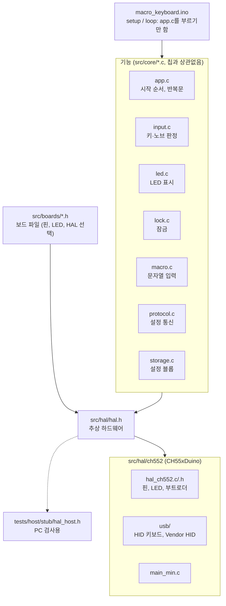

# macro_keyboard: 본 펌웨어 v1.7

- 대상: [docs/BOARDS.md](../../docs/BOARDS.md)의 보드 전부 (CH552G: MK6K1N, MK6K1NL / CH32V203: SAYO_3X3, SAYO_2X4, SAYO_2X6(본 펌웨어 확인 중) / CH573F: SAYO_2B3(본 펌웨어 확인 중)). 보드별 핀은 `docs/board/BOARD_<보드>.md`
- 이 문서의 예시는 MK6K1N 기준
- 키·노브 동작마다 저장된 문자열(매크로)을 HID 키보드 입력으로 출력함
- 요구사항: [docs/REQUIREMENTS.md](../../docs/REQUIREMENTS.md)
- [gui](../../gui/) 설정 프로그램과 [PROTOCOL.md](../../docs/PROTOCOL.md) v2 규격으로 통신함

## 기능

| 항목 | 내용 |
|---|---|
| USB 구성 | 인터페이스 0: HID 키보드, 인터페이스 1: 설정용 Vendor HID (64바이트) |
| 슬롯 | 키 A~F, 노브 시계 방향/반시계 방향/누르기 (9개) |
| 저장 | DataFlash 128바이트. 헤더와 슬롯 길이 정보 26바이트를 빼면 **9개 슬롯 합계 102자** (패턴 암호를 쓰면 `2 + 단계 수`바이트만큼 줄어듦). CH32V203(8·9·12키)은 플래시 끝 4 KB: 9키 합계 4070자, 8키 4072자, 12키 4064자. CH573(SAYO_2B3)은 Data-Flash 2 KB: 6키 합계 2028자 |
| 매크로 | `{ENTER}` `{TAB}` `{UP}` `{F5}` 등 키 이름, `{CTRL+C}` 같은 조합키, `{DELAY:n}`, `{{` `}}` |
| Caps Lock | 켜져 있어도 영문 대소문자가 쓴 그대로 입력되도록 보정 |
| 연속 입력 | 출력 중에 누른 키는 최대 8개까지 순서대로 대기 |
| 잠금 | 패턴 암호 저장 시 꽂을 때마다 잠긴 상태로 시작, 키에 반응 안 함. **노브 2초 누른 뒤** 패턴(2~8단계) 입력하면 풀림. 풀린 상태에서 같은 방법으로 다시 잠금. GUI에서 정한 시간(분) 동안 입력 없으면 자동 잠금(0분 = 안 함). 상태도는 [README의 잠금 상태도](../../README.md#잠금-상태도) |

### LED (WS2812 1개)

| 색 | 의미 |
|---|---|
| 꺼짐 + 3초마다 빨강이 짧게(0.1초) 깜빡 | 잠김: 키를 눌러도 반응 없음. 노브를 2초 눌러 패턴 입력 시작 |
| 빨강 (계속 켜짐) | 패턴 입력 중 (풀기 또는 다시 잠그기) |
| 빨강 깜빡임 (약 0.5초 간격) | 풀기를 5번 틀려서 입력 막음. 다시 꽂아야 함 |
| 파랑 | 풀림 (패턴 암호가 없을 때도) |
| 초록 | 키를 누르는 동안 (짧게 눌러도 최소 0.2초, 노브 회전은 0.2초). 떼면 바로 파랑, 남은 문자열은 파랑인 채 계속 입력. 키마다 LED인 보드는 누른 키만 초록, 나머지는 꺼짐 |
| 흰색 (0.3초) | 설정 저장 완료 |
| 보라 | 부트로더로 들어가는 중 |

- 꽂을 때 LED 점검(`BOARD_LED_SELF_TEST`, 모든 보드): 약 6.3초, `src/core/led.c`
  - 색은 색 바퀴(빨강→노랑→초록→청록→파랑→보라→빨강)를 3초 주기로 2번, 끝나면 0.3초 꺼짐
  - 키마다 LED인 보드(`BOARD_LED_RING`): 빛 하나가 둘레를 1번 키부터 시계방향으로 흐름(이웃한 두 칸 교차 페이드: 현재 칸이 어두워지는 동안 다음 칸이 밝아짐), 한 바퀴 1초. 둘레 순서는 SAYO_3X3 1, 2, 3, 6, 9, 8, 7, 4(가운데 5번은 계속 켜짐), SAYO_2X4 1, 2, 3, 4, 8, 7, 6, 5, SAYO_2X6 1~6, 12~7(빛 2개), MK6K1NL A, B, C, F, E, D
  - MK6K1N: LED 1개라 색 바퀴만
  - 빛 수: 보드 헤더의 `BOARD_LED_RING_CHASE n`(1 이상) = 빛 n개가 둘레에 고르게 떨어져 흐름. 둘레 칸 수가 n으로 나눠져야 함(아니면 빌드 실패). SAYO_2X6은 2, 다른 보드는 1
  - `BOARD_LED_RING_CHASE 0`이면 무지개 회전(모든 칸이 켜진 채 색이 시계방향으로 이동)

### 부트로더 진입 (펌웨어 업데이트)

| 방법 | 동작 |
|---|---|
| **진입 키를 누른 채 USB 연결** | CH552: 키 D(P1.5) → ROM 부트로더. CH32V203: 보드 파일의 `BOARD_BOOT_KEY`(9키 키 7, 8키 키 5) → 자체 HID 부트로더 |
| GUI의 BOOT 명령 | GUI 업데이트 창 [업데이트 모드로 전환]. 잠긴 동안에는 거부 |

- 보드별 진입 키·처음 설치: [docs/BOARDS.md](../../docs/BOARDS.md), CH32V203 부트로더 설계: [BOOTLOADER_CH32V203](../../docs/BOOTLOADER_CH32V203.md)

### 잠금

1. GUI **패턴 암호** 칸에서 키/노브 버튼을 순서대로 눌러 패턴(2~8단계)을 만들고 **[장치에 저장]**
   - 저장 직후에는 풀린 상태 유지, **다음에 꽂을 때부터** 잠김
2. 꽂으면 **잠김** 상태
   - LED 꺼짐, 3초마다 빨강이 짧게 깜빡
   - 키·노브 반응 없음(틀린 횟수에도 안 들어감)
3. **노브를 2초 누르면** LED가 **빨강으로 계속 켜짐** → 노브를 놓고 패턴을 순서대로 입력
   - 노브 누르기 ●도 패턴에 쓸 수 있음
4. 맞으면 LED **파랑**, 평소처럼 동작
   - 패턴 입력은 타이핑되지 않음
   - 이후 키를 누르는 동안 초록
5. 틀리면 잠김(꺼짐 + 가끔 깜빡)으로 돌아감 → 다시 노브 2초부터
   - 빨강인 채로 10초간 입력 없으면 취소, 잠김으로 돌아감(틀린 횟수에 안 들어감)
6. **5번 틀리면** 빨강이 계속 깜빡이며 입력 안 받음 → 다시 꽂으면 재시도 가능
7. **다시 잠그기**: 풀린 상태에서 노브 2초 → 빨강 → 같은 패턴 입력하면 잠김
   - 패턴 입력은 타이핑되지 않음
   - 틀리면 풀린 상태(파랑)로 돌아감
   - **5번 틀리면 그냥 잠김**(차단이 아니라 잠김이라 노브 2초 + 맞는 패턴으로 바로 풀림)
   - 10초간 입력 없으면 잠그지 않고 파랑으로 돌아감

주의할 점:

- 패턴 암호가 저장되어 있으면 노브 누르기 문자열은 **누를 때가 아니라 뗄 때** 입력됨
  - 2초 넘게 누르면 패턴 입력이 시작되고 문자열은 입력 안 됨
  - 패턴 암호가 없으면 누를 때 입력됨
- 2초 누르기는 **꽂은 뒤에** (노브 없는 보드는 진입 키를 누른 채 꽂으면 부트로더)
- **노브 없는 보드(SAYO_3X3, SAYO_2X4, SAYO_2X6)**: 위의 "노브 2초"는 **아무 키 2초** (`src/core/input.c`)
  - 패턴 단계는 키만
  - 키는 항상 누를 때 입력(뗄 때 입력은 늦게 느껴짐). 풀린 상태에서 2초 눌러 다시 잠그면 그 키가 한 번 입력됨
- 잠긴 동안 GUI에서 읽기·테스트 입력 안 됨
- 패턴을 잊으면 GUI에서 새 설정을 **[장치에 저장]** (기존 문자열과 패턴은 모두 지워짐)
- 잠금은 주변 사람이 키를 눌러 보는 것을 막는 정도임
  - 펌웨어를 새로 구워 DataFlash를 읽는 것은 못 막음 → 비밀번호 같은 민감한 문자열은 저장하지 말 것

### 이력 (기능)

- v1.0: 문자열 입력, 부트로더 진입 LED 빨강(v1.1부터 보라)
- v1.1: 패턴 암호. v1.2: 노브 길게 누르기로 입력 시작, 다시 잠그기
- v1.4: 자동 잠금. v1.6: 패턴 2단계부터(전에는 4단계)
- 2026-11-07: 노브 없는 보드는 키를 누를 때 입력(전에는 뗄 때). CH552 보드의 "노브를 누른 채 꽂기" 진입 삭제
- 2026-11-07: 초록 = 키를 누르는 동안(전에는 출력하는 동안)
- 2026-11-07: 누르는 동안 나머지 LED 꺼짐(전에는 파랑)
- 2026-11-07: 1.7.0(CH32V203 지원, 노브 진입 삭제, 초록 LED 변경, CH552 색 바퀴)
- 2026-11-10: 키마다 LED인 보드의 LED 점검이 둘레를 흐르는 빛으로 회전
- 2026-11-13: SAYO_2B3(옛 이름 BT_2X3)용 `battery.c`·`bt_led.c`와 CH573 부품 추가(앱 연결 전)
- 2026-11-13: SAYO_2B3 본 펌웨어 1단계(CH573, USB 유선, BLE 없음) `Makefile.ch573`, `bt_app.c`
- 2026-11-14: SAYO_2B3 BLE HID 1단계(`ble_ch573.c`, 본딩 1대), 배터리 상태 명령 `0x07`, 설정 RAM 버퍼 하나(`BOARD_STORE_ONE_BUFFER`). 기판에서 유·무선 입력·전환·배터리 % 확인
- 2026-11-13: SAYO_2X6(12키) 추가, LED 점검 빛 수 `BOARD_LED_RING_CHASE n`

## 빌드

- **CH32V203 보드(SAYO_3X3, SAYO_2X4, SAYO_2X6)**: `Makefile.ch32v203` 사용. xPack riscv-none-elf-gcc + `mingw32-make`, WCH EVT SDK 필요
  (경로·주의점은 [PORT_CH32V203](../../docs/old/PORT_CH32V203.md), [test_ch32v203](../../tests/hw/ch32v203/test_ch32v203/README.md)). 아래 Arduino 설명은 CH552용
  - `BOOTLOADER ?= 1`(기본): 자체 부트로더용. 앱 시작 0x08002000, 최대 52992 B. `BOOTLOADER=0`은 부트로더 없는 배치(바꾸면 `rm -rf build`)
  - 보통은 `tools\build_fw.ps1 -Board sayo_3x3` → 앱 `.bin` + 부트로더 + 전체 이미지 ([BOOTLOADER_CH32V203](../../docs/BOOTLOADER_CH32V203.md) 빌드)
  - 목적 파일: 보드별 `build/ch32v203/obj-<BOARD>/`. `.bin`은 `build/ch32v203/macro_keyboard-<BOARD>.bin`. `build_fw.ps1`은 그 보드의 파일만 지우고 다시 빌드
  - 헤더 의존성(`-MMD -MP`): 헤더만 고쳐도 그 헤더를 쓰는 파일을 다시 빌드. Makefile을 고친 뒤에는 그대로 `rm -rf build`
  - 부트로더 `make full`은 `EXTRA_DEFS`(빌드 날짜)를 받아 앱 빌드에 넘김
  - 도구 경로: 환경 변수 `MK_EVT_SDK`(WCH EVT SDK), `MK_RISCV_BIN`(riscv-none-elf-gcc `bin` 폴더), `MK_WCHISP`(wchisp.exe)가 있으면 기본 경로보다 먼저 씀. Makefile 4개(본 펌웨어, 부트로더, test_ch32v203, diag)와 `tools\build_fw.ps1`·`flash.ps1` 공통
- **CH573 보드(SAYO_2B3)**: `Makefile.ch573`, SDK 경로 `MK_CH57X_SDK` → [아래 CH573 빌드](#ch573-빌드-sayo_2b3), 부트로더 [BOOTLOADER_CH573](../../docs/BOOTLOADER_CH573.md)

- Arduino IDE + CH55xDuino 0.0.26
- Windows는 [TROUBLESHOOTING 1-1](../../docs/TROUBLESHOOTING.md)의 `sdcc.sh` 패치 필요

| Tools 메뉴 | 값 |
|---|---|
| Board | CH552 Board |
| Clock Source | 24 MHz (internal), 5V |
| USB Settings | **USER CODE w/ 266B USB ram** ⚠️ test_pinmap(148B)과 다름 |
| Bootloader pin | **P1.5 pull-down** |

**빌드 스크립트 (권장)**

- 저장소 폴더에서 실행, 위 보드 설정으로 빌드하고 **빌드한 시각**을 펌웨어에 넣음
- 결과: `firmware\macro_keyboard\build\macro_keyboard.ino.hex`

```powershell
powershell -ExecutionPolicy Bypass -File tools\build_fw.ps1
```

**Arduino IDE**

- **Sketch → Export Compiled Binary** → `build\CH55xDuino.mcs51.ch552\macro_keyboard.ino.hex` 생성
- 빌드 날짜가 안 들어감(GUI에 `빌드 날짜 없음`)

### CH573 빌드 (SAYO_2B3)

- 단계: **BLE 1단계**(USB 유선 키보드 + BLE HID 키보드 본딩 1대 + 상태 LED + 배터리). 슬롯 3개·동글 연결은 2단계
- 도구: xPack riscv-none-elf-gcc, `mingw32-make`, WCH CH573 EVT SDK(`MK_CH57X_SDK`, 기본 `C:/Users/user/tools/sdk_ch573/EVT`)
- 보통은 `tools\build_fw.ps1 -Board sayo_2b3`: 앱 + 자체 부트로더 + 첫 설치 이미지를 한 번에(`Makefile.ch573 full`)
- `firmware\macro_keyboard`에서

| 명령 | 결과 |
|---|---|
| `mingw32-make -f Makefile.ch573` | `build/ch573/macro_keyboard-SAYO_2B3.bin` (앱, 0x3000에 링크) |
| `mingw32-make -f Makefile.ch573 DEMO=1` | `…-SAYO_2B3-demo.bin`: 키가 입력 대신 상태 LED를 바꾸는 시험판 |
| `mingw32-make -f Makefile.ch573 full` | `…-SAYO_2B3-full.bin`: 자체 부트로더 + 앱 정보 + 앱(`firmware/bootloader_ch573/mkfull.py`). 처음 설치용(wchisp) |

- 배치: 자체 부트로더 뒤 0x3000, 최대 446,464 B. 숫자는 `firmware/bootloader_ch573/boot_layout.h`에서 읽음
- 설정 저장: Data-Flash 0~2,047(블롭 2048 B, `STORE_SIZE`). 슬롯 상태 0x7000, BLE 짝 정보 0x7C00~0x8000(본딩 4개)과 안 겹침
- 보드 헤더: `src/hal/ch573/sayo_2b3.h`(GUI 보드 목록 등록 전이라 `src/boards` 밖, `-DBOARD_HEADER`로 넘김). 칩 정의 `MK_CHIP_CH573`
- 소스: `src/core/`(공통) + `battery.c`·`bt_led.c`·`bt_app.c`(이 보드만) + `src/hal/ch573/` + SDK 드라이버(clk, gpio, sys, timer0, pwr, adc)
  - BLE: WCH BLE 라이브러리(EVT `BLE/LIB`, `HAL/MCU.c`·`RTC.c`)와 `HID_Keyboard` 프로필(hiddev, HID·배터리·기기 정보·스캔 변수 서비스). SDK 예제의 APP 자리는 `src/hal/ch573/ble_ch573.c`
  - BLE 힙 `BLE_HEAP` 5,120 B(기본, `BLE_HEAP=6144`로 바꿀 수 있음). 링크 뒤 `.bss` 위 남는 RAM이 1 KB 미만이면 빌드 실패
  - RAM 절약: 설정 RAM 버퍼 하나(`BOARD_STORE_ONE_BUFFER`, 아래 코드 구조), 2 KB 그림자 대신 256 B 페이지 캐시, USB 인터럽트 본체는 플래시에
- Makefile을 고친 뒤에는 `build/ch573` 지우기
- 장입: GUI 업데이트 창 또는 `tools\flash.ps1 -Board sayo_2b3`(자체 부트로더, 진입: 키 4를 누른 채 SW1 켜기 또는 `-Enter`). 처음 설치는 `-Full`(PB22 + wchisp, UID 확인) → [BOOTLOADER_CH573](../../docs/BOOTLOADER_CH573.md#설치업데이트)
- 동작·LED: [BOARD_SAYO_2X3B_RGB 6절](../../docs/board/BOARD_SAYO_2X3B_RGB.md#6-본-펌웨어에서의-동작)

### AC6321A 빌드 (JUZH_3B4, 준비 중, 칩 미검증)

- 구조: JieLi SDK 앱(fw-AC63_BT_SDK, `cpu/bd19`, `ac632n_hid`). `main()`·USB·BLE 스택은 SDK, `src/hal/ac6321a/`가 SDK 앱 "standard_keyboard" 자리에 등록하고 RTOS 태스크 하나에서 core를 돌림
- 도구: JL 툴체인 2.5.3(`C:\JL`, clang pi32), bash, `mingw32-make`
- `firmware\macro_keyboard`에서

| 명령 | 결과 |
|---|---|
| `mingw32-make -f Makefile.ac6321a` (= `bash jl_build_ac6321a.sh`) | `build/ac6321a/macro_keyboard-JUZH_3B4.bin`·`.elf` (앱만) |
| `mingw32-make -f Makefile.ac6321a BLE=0` | 같은 파일, USB만(BLE 스택 부르지 않음) |

- 환경 변수: `MK_JL_SDK`(SDK 원본, 손대지 않음), `MK_JL_WORK`(작업 사본, 기본 `C:/Users/user/tools/jieli/mk_sdk`), `MK_JL_TOOLCHAIN`(기본 `C:/JL/pi32/bin`)
- 작업 사본에서 매번 SDK 설정을 새로 복사해 고침: 보드 `AC6321A_STAND_KEYBOARD`, USB 장치 켬, 디버그 UART0 끔(TX = USB0 DP), SDK 행렬 키·외부 MCU 끔, BLE는 `BLE=` 값
- SDK 키보드 앱·HID 클래스(`usb_hid_devices.c`)·장치 서술자(`descriptor.c`)는 빼고 `usb_ac6321a.c`로 대체
- 빌드 뒤 스크립트(`RUN_POST_SCRIPT`)는 끔: SDK `download.bat`이 `isd_download -tonorflash`로 꽂힌 칩에 씀. 장입 대상 없음(일부러)
- `.bin`은 앱만. 플래시 이미지(uboot·설정·파티션)는 `isd_download`가 만듦
- 보드 헤더: `src/hal/ac6321a/juzh_3b4.h`(GUI 보드 표 등록 전이라 `src/boards` 밖). **핀은 모두 `PIN_NONE`**(측정 뒤 채움)
- 기능(초안)
  - USB: 부트 키보드 + 벤더 HID 64 B, `1209:C55D`
  - BLE HID: SDK HOGP, Report ID 1, 본딩 1개
  - 설정 저장: SDK VM 항목(2 KB = 256 B × 8)
  - 입력: 3×4 행렬 키, 노브 2개
  - 슬롯 LED 3개(임시 대응: 파랑 = 슬롯, 초록 LED2, 빨강 LED3, 흰색 LED1, 확인 필요)
  - 업데이트 진입: BOOT 명령, 공장과 같은 `03 EF EF`(Report ID 없는 64 B만) → `go_mask_usb_updata()` → ROM UBOOT
  - HELLO 칩 ID 미정(0)
- core 노브 2개: `BOARD_KNOBS > 1`일 때만 쓰는 경로, 노브 n의 슬롯은 K + 3n(K = 키 수). 노브 1개 보드 코드는 그대로
- 보드 문서: [BOARD_KEY12_JUZHEN_V01](../../docs/board/BOARD_KEY12_JUZHEN_V01.md#6-본-펌웨어에서의-동작)

### 버전과 빌드 날짜

- **버전**: `src/config.h`의 `FW_MAJOR`, `FW_MINOR`, `FW_PATCH`를 직접 고침(지금 `1.7.0`)
  - USB 장치 정보(bcdDevice)에도 같은 값이 들어감
- **빌드 날짜**: `tools/build_fw.ps1`이 빌드 순간의 시각을 컴파일 옵션(`-DFW_BUILD_YEAR=2026` 등)으로 넘김
  - 컴파일러의 `__DATE__`를 안 쓰는 이유: Arduino는 바뀌지 않은 파일을 다시 컴파일하지 않아 예전 날짜가 남음
- GUI 연결 막대 표시: `펌웨어 v1.7.0 (빌드 2026-11-07 12:44)` 형식

### 크기

- 현재(1.7.1, 2026-11-16 빌드): SAYO_3X3 앱 12,576바이트, SAYO_2X4 12,564바이트, SAYO_2X6 12,608바이트(앱 영역 최대 52,992바이트). CH552는 1.7.0에서 잰 값: MK6K1N 9,629바이트, MK6K1NL 10,006바이트(최대 14,336바이트, 1.7.1 값 확인 필요). 빌드 시각에 따라 ±4바이트
- SAYO_2B3(CH573, 블루투스 슬롯 3개): 앱 131,656바이트(2026-11-16 빌드, 장입판 131,648바이트, BLE 라이브러리 포함, 앱 영역 최대 446,464바이트), 자체 부트로더 5,204바이트. RAM 여유 1,168바이트 + 스택 512바이트

**이력 (크기)**

- 2026-10-31 (v1.6.0, HAL 분리 후):

| 보드 | 코드 | 전역 변수 | 스택 | 비고 |
|---|---|---|---|---|
| MK6K1N | 8694바이트(60%) | 360바이트 | 126바이트 | 나누기 전 8610바이트 |
| MK6K1NL | 8915바이트(62%) | 358바이트 | 120바이트 | 키별 LED 표시. 나누기 전 8795바이트 |

- HAL 분리([코드 구조](#코드-구조))로 모듈 사이 호출이 늘어 84~120바이트 커짐
- 2026-11-07 (1.7.0): 색 바퀴 점검(CH552도), 초록 LED 변경 → 위 현재 크기
- 2026-11-16 (1.7.1): CH32V203 보드 다시 잼(SAYO_2X6 추가), SAYO_2B3 블루투스 슬롯 3개 판
- 2026-11-07: "노브를 누른 채 꽂기" 진입 삭제 → MK6K1N 8,726, MK6K1NL 8,949바이트
- 그 전 버전(MK6K1N 기준, 변화는 바로 아래 버전 대비):

| 버전 | 크기 | 변화 |
|---|---|---|
| v1.5.0 | 8608바이트 (MK6K1NL 8895) | 노브 판정 변경(+14바이트): 한 칸 안에서 2단계 이상 같은 방향이어야 회전 |
| v1.4.1 | 8594바이트 | USB 전송 멈춤 처리(+148바이트) |
| v1.4.0 | 8446바이트 | 자동 잠금(+178바이트) |
| v1.3.x | 8268바이트 | v1.3.0: HELLO 보드 정보와 펌웨어 식별 문자열(+117바이트) |
| v1.2.1 | 8151바이트 | 기능 그대로, 크기만 줄임([docs/old/FIRMWARE_SIZE.md](../../docs/old/FIRMWARE_SIZE.md)) |
| v1.2.0 | 11587바이트(80%) | – |

### 보드 파일

- 칩, 키/노브 수, 키 배치 행 수, 보드 이름, 핀 배치, LED 수는 **보드 파일** `src/boards/<보드>.h`에 있음([docs/BOARD_INFO.md](../../docs/BOARD_INFO.md) 6)

| 보드 파일 | 보드 | LED | 하드웨어 확인 |
|---|---|---|---|
| `mk6k1n.h` | MK6K1N: 6키 + 노브 | 눈에 보이는 LED 1개(체인 위치를 몰라 8자리에 같은 색) | [BOARD_MK6K1N](../../docs/board/BOARD_MK6K1N.md) |
| `mk6k1nl.h` | MK6K1NL: 6키 + 노브, 핀은 MK6K1N과 같음 | **키마다 1개**(체인 0~5 = 키 A~F). 누르는 동안 누른 키만 초록, 나머지는 꺼짐(평소 모두 파랑). 패턴 입력 중(전체 빨강)에는 누른 키만 잠깐 꺼짐 | [BOARD_MK6K1NL](../../docs/board/BOARD_MK6K1NL.md) |
| `sayo_3x3.h` | SAYO_3X3: 9키 (CH32V203) | 키마다 RGB (색별 캐소드 + 키별 애노드) | [BOARD_SAYO_3X3](../../docs/board/BOARD_SAYO_3X3_RGB.md) |
| `sayo_2x4.h` | SAYO_2X4: 8키 (CH32V203) | 키마다 RGB (9키와 같은 방식) | [BOARD_SAYO_2X4](../../docs/board/BOARD_SAYO_2X4_RGB.md) |
| `sayo_2x6.h` | SAYO_2X6: 12키 (CH32V203, 기판 `2x6_RGB`) | 키마다 RGB (9키와 같은 방식) | [BOARD_SAYO_2X6_RGB](../../docs/board/BOARD_SAYO_2X6_RGB.md) (본 펌웨어 확인 중) |

- **공통 기판 파일** `ch552_6k1n.h`: 두 보드가 같은 기판이라 칩·키/노브 수·행 수·핀·스위치 비트 표·핀 배치 검사(`#error`)를 한 곳에 둠
  - HAL 선택(`BOARD_HAL_CH55X`)도 여기서 정함
- `mk6k1n.h` / `mk6k1nl.h`: 각자 이름(`BOARD_NAME`)과 LED(`BOARD_LED_COUNT`, `BOARD_KEY_LEDS`: 1 = LED i가 키 i 아래)를 정한 뒤 `ch552_6k1n.h`를 include함
- 보드 요약: [docs/BOARDS.md](../../docs/BOARDS.md), 핀 그림: `docs/board/BOARD_<보드>.md`
- 새 보드 추가:
  - 기판(핀)이 같으면: 이름과 LED만 정한 보드 파일 하나
  - 기판이 다르면: `<칩>_<배치>.h` 같은 공통 파일도 새로 만들고, `src/config.h`의 고르기 목록과 `tools/build_fw.ps1`의 `$boardChips`에 더함
- 빌드 시 보드 고르기:

| 명령 | 매크로 | 추가 복사본 |
|---|---|---|
| `tools/build_fw.ps1 -Board mk6k1n` | `-DBOARD_MK6K1N` | `build/macro_keyboard-MK6K1N.hex` |
| `tools/build_fw.ps1 -Board mk6k1nl` | `-DBOARD_MK6K1NL` | `build/macro_keyboard-MK6K1NL.hex` |
| `tools/build_fw.ps1 -Board sayo_3x3` / `sayo_2x4` / `sayo_2x6` | `BOARD=SAYO_3X3` / `SAYO_2X4` / `SAYO_2X6` (`Makefile.ch32v203`) | `build/ch32v203/macro_keyboard-<보드>.bin`(목적 파일 `obj-<보드>/`), 전체 이미지 `full-<보드>.bin`(`flash.ps1`은 안 씀) |
| `-Board` 생략, Arduino IDE 빌드 | 없음 → `mk6k1n` | – |

- `macro_keyboard-<보드>.hex`는 GUI 펌웨어 업데이트 창이 먼저 고르는 파일
- 보드 정보 전달:
  - HELLO 바이트 17~35([docs/PROTOCOL.md](../../docs/PROTOCOL.md))
  - hex 안 식별 문자열 `MKFW1:<보드>:<칩>:<버전>`(예: `MKFW1:MK6K1N:CH552:1.3.0`) → GUI가 올리기 전에 보드와 칩 확인
- 보드 이름은 GUI 보드 목록 `gui/core/boards.py`와 같아야 함

## 업로드

**GUI (가장 쉬움)**

- 이 펌웨어(v1.0 이상)가 이미 올라가 있으면 **GUI의 [펌웨어 업데이트]** 사용
- 잠금이 풀린 키보드는 GUI가 BOOT 명령으로 업데이트 모드에 넣음 → 진입 키 누를 필요 없음
- 절차·처음 설치·복구(모든 보드): [사용 설명서 8장](../../docs/MANUAL.md#8-펌웨어-업데이트)

**스크립트 (CH552 보드)**

- CH32V203 보드: [사용 설명서 8장 "스크립트로 올리기"](../../docs/MANUAL.md#스크립트로-올리기)
- CH573 보드(SAYO_2B3): `tools\flash.ps1 -Board sayo_2b3`, 자세히는 [CH573 빌드](#ch573-빌드-sayo_2b3)의 장입

1. 저장소 폴더에서 실행
2. **키 D를 누른 채** 키보드 연결
3. 아래 명령 실행 (`build_fw.ps1`로 빌드한 경우)

```powershell
powershell -ExecutionPolicy Bypass -File tools\flash.ps1 -Hex firmware\macro_keyboard\build\macro_keyboard.ino.hex
```

- Arduino IDE로 빌드했으면 `-Hex firmware\macro_keyboard\build\CH55xDuino.mcs51.ch552\macro_keyboard.ino.hex`

**업로드 후**

- LED **파랑** = 펌웨어 실행 중
- 처음에는 **모든 슬롯이 빈 상태**로 시작함(DataFlash에 이전 제조사 설정이 남아 있어도 형식이 맞지 않음)

## 동작 테스트

### 1. 연결 확인

1. GUI 실행: `uv run python -m gui`
2. 상단에 `● 연결됨 - …`, `MK6K1N (키 6 + 노브 1) / 용량 128바이트`, `펌웨어 v1.7.0 (빌드 …)` 표시되면 설정 통신 정상
   - 빌드 날짜가 방금 빌드한 시각인지 확인(새 펌웨어가 올라갔다는 표시)
3. 처음에는 "설정 없음"으로 빈 슬롯 9개 표시

### 2. 테스트 문자열 넣기

- 아래 문자열을 슬롯마다 입력하고 **[장치에 저장]** (9개 합계 85자, 전체 111 / 128바이트)
- LED가 흰색으로 잠깐 빛나면 저장 완료

| 슬롯 | 테스트 문자열 | 확인하는 것 |
|---|---|---|
| 키 A | `Hello, World!{ENTER}` | 대소문자, 기호, Enter |
| 키 B | `abc{DELAY:1000}def` | 1초 쉬었다가 이어서 입력 |
| 키 C | `{{OK}}` | 중괄호 입력 → `{OK}` |
| 키 D | `{CTRL+A}` | 조합키 (전체 선택) |
| 키 E | `{CTRL+C}` | 조합키 (복사) |
| 키 F | `{CTRL+V}` | 조합키 (붙여넣기) |
| 노브 시계 방향 | `{DOWN}` | 한 칸마다 아래 화살표 |
| 노브 반시계 방향 | `{UP}` | 한 칸마다 위 화살표 |
| 노브 누르기 | `{ENTER}` | Enter |

### 3. 키보드로 확인

1. **메모장**을 열고 **영문 입력 모드**로 둠
2. 키 A → `Hello, World!` 입력 후 줄바꿈
3. 키 B → `abc` 입력, 1초 뒤 `def`
4. 키 C → `{OK}`
5. 키 D(전체 선택) → 키 E(복사) → 메모장 끝 클릭 → 키 F(붙여넣기)
6. 노브를 돌려 커서가 위/아래로 움직이는지, 노브를 눌러 줄바꿈되는지 확인
7. **Caps Lock을 켜고** 키 A를 다시 눌러도 `Hello, World!` 그대로 나오는지 확인
8. USB를 뺐다 다시 꽂고, GUI **[장치에서 읽기]**로 저장한 문자열이 남아 있는지 확인

- GUI **[테스트 입력]**: 키를 누르지 않고 선택한 슬롯을 입력해 봄(3초 카운트다운 뒤 포커스된 창에 입력)

### 4. 잠금 확인

1. GUI 패턴 암호에 `A → B → C → ↻`(키 A, B, C, 노브 시계 방향 한 칸)를 넣고 저장(전체 117 / 128바이트). LED는 파랑 그대로
2. USB를 뺐다 다시 꽂음 → LED **빨강**, GUI 상단에 `🔒 잠김 - 키보드에서 노브를 2초 누른 뒤 패턴 암호를 입력하세요` 표시
3. 메모장에서 키 A를 눌러도 아무것도 입력 안 되는지 확인
4. 노브를 누르지 않고 `A, B, C, ↻`를 입력해도 안 풀리는지 확인
5. 노브 2초 → **빨강이 계속 켜지면** `A, B, D, ↻`처럼 틀리게 입력 → 잠김(꺼짐 + 가끔 깜빡)으로 돌아오는지 확인
6. 다시 노브 2초 → `A, B, C, ↻` 입력 → LED **파랑**, 2초 안에 GUI가 `● 연결됨`으로 바뀌고 설정을 읽어 오는지 확인
7. 노브를 짧게 누르면 노브 누르기 문자열이 (뗄 때) 입력되는지 확인
8. **다시 잠그기**: 노브 2초 → 빨강 → `A, B, C, ↻` 입력 → 잠김(꺼짐 + 가끔 깜빡)이 되고 2초 안에 GUI가 `🔒 잠김`으로 바뀌는지 확인
   - 다시 푼 뒤 다시 잠그기를 5번 틀리면 5번째에 잠기는지도 확인
9. 다시 꽂은 뒤 5번 틀리게 입력(매번 노브 2초 후) → 빨강 깜빡임, 맞는 패턴도 안 받는지 확인
10. **자동 잠금**: 풀린 상태에서 GUI 자동 잠금을 `1분`으로 저장(설정이 3바이트 늘어남)
    - 아무것도 안 누르고 1분 기다림 → 잠김(꺼짐 + 가끔 깜빡), 2초 안에 GUI가 `🔒 잠김`으로 바뀌는지 확인
    - 다시 풀고 1분 전에 키 하나 누르면 그때부터 1분을 새로 세는지 확인
11. 끝나면 GUI에서 패턴 암호 **모두 지우기** 후 저장 → 잠금 꺼짐(자동 잠금도 함께 0분)

### 5. 용량 확인

- GUI 아래쪽 막대에 `N자 입력 · M자 더 입력 가능 (사용 / 128 바이트)` 표시
- 128바이트를 넘으면 빨간색으로 바뀌고 저장 버튼 꺼짐

## 문제가 생기면

| 증상 | 확인할 것 |
|---|---|
| 업로드 후 키보드로 인식되지 않음 | 장치 관리자에 "알 수 없는 장치"가 보이면 USB Settings가 **266B**였는지 확인하고 다시 빌드 |
| GUI가 "연결 안 됨" | 장치 관리자 HID 장치에 `Mini Macro Kbd`가 두 개(키보드, 공급업체 정의 장치) 있는지 확인. 다른 GUI 창이 장치를 잡고 있지 않은지 확인 |
| 영문 대신 한글이 입력됨 | 한/영 키로 영문 모드 전환 ([TROUBLESHOOTING 3-1](../../docs/TROUBLESHOOTING.md)) |
| 다시 업로드해야 함 | 키 D를 누른 채 연결 |
| 패턴 암호를 잊음 | 잠긴 채로 GUI에서 새 설정 **[장치에 저장]** (기존 문자열과 패턴은 지워지고 되찾을 수 없음). 펌웨어를 다시 올려도 DataFlash 설정은 안 지워지므로 그것으로는 안 풀림 |

- 자세한 내용: [docs/TROUBLESHOOTING.md](../../docs/TROUBLESHOOTING.md)

## 코드 구조

- 기능 코드와 하드웨어를 나눔
- 기능 코드(`src/core/*.c`)는 하드웨어를 **`src/hal/hal.h`의 이름으로만** 씀
  - 시간, 스위치, 노브 선, LED, 설정 저장, HID 키보드, 설정 통신, 부트로더
- 칩별 구현은 `src/hal/<칩>/`. 보드 파일의 `BOARD_HAL_CH55X`를 보고 `hal.h`가 고름
- CH55x에서는 대부분 매크로라 HAL 계층 자체는 코드가 거의 늘지 않음
- 시작 순서와 반복문은 `src/core/app.c` 하나. 칩별 시작점(CH552 `macro_keyboard.ino`, CH32V203 `src/hal/ch32v203/main.c`)은 `app_setup()`/`app_loop()`만 부름
- CH32V203 전용 파일은 `#ifdef __riscv`로 감쌈(Arduino 빌드가 `src/` 아래 .c를 모두 컴파일하므로)



| 파일 | 내용 |
|---|---|
| `macro_keyboard.ino` | CH552 시작점: `setup()`/`loop()`에서 `app_setup()`/`app_loop()`만 부름 |
| `src/core/app.c/.h` | 시작 순서(HAL, 저장, 잠금, 입력, USB)와 반복문(통신, 입력, 잠금, 문자열, LED), BOOT·저장 알림 처리 |
| `src/config.h` | 버전, 빌드 날짜, USB ID, 보드 파일 고르기, 슬롯 번호, 용량, 잠금 설정값 |
| `src/boards/ch552_6k1n.h` | 6키 + 노브 CH552G 기판: HAL 선택, 칩, 키/노브/행 수, 핀 배치, 스위치 비트 표, 핀 배치 검사 (MK6K1N, MK6K1NL 공통) |
| `src/boards/mk6k1n.h`, `mk6k1nl.h` | 보드 이름과 LED (LED 1개를 8자리로 / 키마다 1개) |
| `src/core/input.c/.h` | 스위치 디바운스(20ms), 노브 판정(한 칸 중 2단계 이상), 노브 길게 누르기, 입력을 잠금/문자열 입력으로 보내기 |
| `src/core/led.c/.h` | LED 표시 정책(색, 깜빡임, 키별 초록/꺼짐), 색 번호 `COLOR_*`(`led.h`)와 색 표 `hal_palette` |
| `src/core/lock.c/.h` | 잠금 상태, 패턴 입력 판정, 틀린 횟수, 자동 잠금 시간 |
| `src/core/protocol.c/.h` | Vendor HID 명령 처리 (HELLO/READ/WRITE/COMMIT/TEST/BOOT, 배터리 보드는 BATTERY), HELLO 보드 정보, 펌웨어 식별 문자열 |
| `src/core/storage.c/.h` | 설정 블롭 저장, CRC 검사, 슬롯 찾기 (문자열, 패턴 암호, 설정 슬롯). 보드 옵션 `BOARD_STORE_ONE_BUFFER`(지금 SAYO_2B3만): RAM 버퍼 하나로 받음 → 받는 중엔 슬롯 길이 0, 잠금 단계·자동 잠금 분은 따로 보관, COMMIT 거부 때 저장본 다시 읽음 |
| `src/core/macro.c/.h` | 매크로 해석과 비동기 출력 (키 누름/뗌, DELAY) |
| `src/core/battery.c/.h` | 배터리 추정(`BOARD_BATTERY` 보드만, 다른 보드 0 B): VDD + 650 mV, 4회 평활, Li-Po 곡선 %, 저전압 3.4 V·위험 3.1 V 플래그, 케이블 꽂기 전 값 보관, 배터리 상태 명령 결과(`battery_report`). LED 표시 없음 |
| `src/core/bt_led.c/.h` | SAYO_2B3 상태 LED(`BOARD_BT_LED` 보드만, 다른 보드 0 B): 슬롯 파랑, 동글·유선 초록, 저전압 빨강, 키 흰색, 잔량 표시. 시간·값은 `bt_led.h` 상수 ([BOARD_SAYO_2X3B_RGB 4절](../../docs/board/BOARD_SAYO_2X3B_RGB.md#led-의미)) |
| `src/hal/hal.h` | **추상 하드웨어**: 기능 코드가 쓰는 이름 목록과 설명, 칩 구현 고르기 |
| `src/hal/ch552/hal_ch552.c/.h` | CH55x 구현: 핀 설정, 스위치·노브 읽기(포트 직접), WS2812 LED, DataFlash(코어 `eeprom_*` 매크로), 칩 고유 ID, 부트로더 |
| `src/hal/ch552/usb/` | USB 디스크립터, 요청 처리, 엔드포인트 (CH55xDuino qmkCompatibleKeyboard 예제 기반, LGPL-2.1) |
| `src/hal/ch552/main_min.c` | 코어의 `main.c` 대신 쓰는 작은 `main()`과 인터럽트 표(USB, Timer0) |
| `src/core/bt_app.c/.h` | SAYO_2B3 앱 동작: 키 흰색, USB 연결 초록, 배터리 10초마다 측정·저전압 빨강·위험 시 절전(USB 연결 중엔 안 함), 키 1+6 1초 잔량 파랑, `DEMO=1` 시험 동작. BLE(`BOARD_BLE`): USB 연결 중엔 끊고 광고 멈춤, 광고 60초 뒤 멈춤·키로 재시작, 키 5 누른 채 켜면 페어링 |
| `src/hal/ch573/` | CH573 HAL(`hal_ch573.c`, `main.c`: TMR0, 키, Data-Flash 설정, USB 부트 키보드 + 벤더 HID `1209:C55D`, BOOT, 절전), `ble_ch573.c`(BLE HID 키보드: 광고·본딩·보고서·배터리 서비스), 보드 파일 `sayo_2b3.h`, `battery_ch573.c`(VBAT −12 dB, 16회 평균), `led_ch573.c`(상태 LED 핀) |

### PC 검사 (tests/host)

- `tests/host/run.py`로 기능 코드(`src/core`의 `storage.c`, `macro.c`, `lock.c`, `input.c`, `led.c`, `protocol.c`)를 PC(gcc)에서 검사함
- `src/boards`의 **모든 보드**를 빌드해 돎. 그 밖에 시험용 보드 `TEST_BAT`(배터리 명령), SAYO_2B3 `bt_app` 시험(`bt_app_test.c`)
- 보통은 `uv run pytest` 한 번으로 실행됨(`tests/gui/test_host_firmware.py` 래퍼, gcc 없으면 skip). 교차 검사(`test_consistency.py`)도 함께
- 하드웨어 대신 `tests/host/stub/hal_host.h` 사용
- 확인 항목:
  - GUI 인코더로 만든 블롭 저장
  - 각 슬롯이 보내는 HID 키 코드
  - 패턴 암호 판정
  - 가짜 스위치·노브 선을 넣었을 때의 입력과 LED 표시
  - `protocol.c`의 HELLO·READ·WRITE·COMMIT 응답을 GUI 파서로 해석
  - 보드 이름 8자 검사(gcc에서만, SDCC는 코드 크기 때문에 끔)
  - 배터리 상태 명령(`0x07`): 배터리 보드만 응답, 다른 보드 `BAD_CMD`
  - 버퍼 하나 저장(`BOARD_STORE_ONE_BUFFER`): 받는 중 동작, COMMIT 거부 뒤 복구
  - `bt_app` BLE 시나리오: USB 대기, 재연결, 60초 광고 멈춤, 키로 재시작, 페어링 부팅, USB 꽂고 빼기

```powershell
uv run python tests\host\run.py
```
